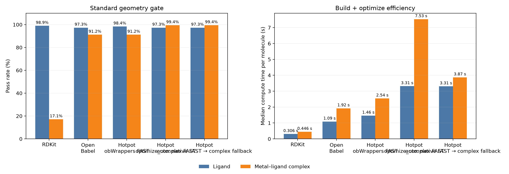
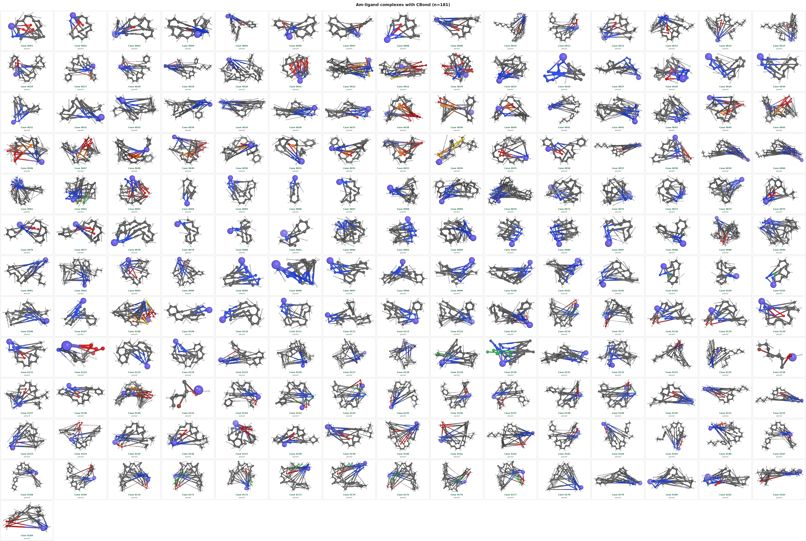
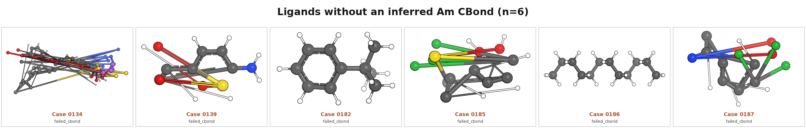

# 🥘 Hotpot (火锅)

**A cheminformatics harness for coordination chemistry**

**HOTPOT** — a **H**uman- and LLM-**O**riented **T**oolkit with chemical
**P**riors for **O**pen-ended cheminformatics **T**asks.

> **In Hotpot, every ingredient is cookable.** 什么都能涮
> **In data-driven chemistry, every problem is computable.** 什么都能算

Hotpot presents chemistry through two equally important conceptual entry
points: `Molecule` for molecular systems and `Crystal` for periodic systems.
`Molecule` is the mature working interface today; `Crystal` defines an equal
part of the long-term public model and remains under active development.

Hotpot is designed around four layers:

1. a frontend that chemists can read and use directly;
2. a structured CLI that language models and automation agents can call
   reliably;
3. a silent cheminformatics layer that applies domain rules without burdening
   the caller with implementation details; and
4. AI backends exposed as chemistry operations with training details kept
   behind the backend boundary.

The public documentation therefore focuses on observable behavior, scientific
scope, and stable interfaces. Internal chemical decision policies and model
implementation details are intentionally kept outside the user-facing API.
The preceding project description is preserved as
[README.2026.md](README.2026.md) for historical reference; this document is
the description of the current checkout.

## Contents

- [Command-line interface](#command-line-interface)
- [Installation](#installation)
- [Python interface](#python-interface)
- [Chemistry capabilities](#chemistry-capabilities)
- [Geometry and force-field validation](#geometry-and-force-field-validation)
- [Validation evidence](#validation-evidence)
- [Scientific boundaries](#scientific-boundaries)
- [References](#references)
- [Roadmap](#roadmap)
- [Development](#development)

## Command-line interface

The CLI is the preferred interface for shell workflows, language-model tool
use, and reproducible pipelines. Every primary chemistry command accepts
`--help`; commands with longer usage guides also accept `--doc`.

| Command | Purpose | Typical output | Detailed guide |
|---|---|---|---|
| `hotpot mca` | Predict site-resolved methyl cation affinity (MCA) | Atom table in kJ/mol | [MCA CLI](hotpot/cheminfo/AImodels/mca/cli_doc.md) |
| `hotpot cbond` | Predict and construct metal–ligand coordination bonds | Complex SMILES or ranked structures | [CBond CLI](hotpot/cheminfo/AImodels/cbond/cli_doc.md) |
| `hotpot ff` | Build or optimize 3D molecular structures and report quality | Molecular structure file and optional JSON report | [Force-field CLI](hotpot/cheminfo/forcefields/cli_doc.md) |
| `hotpot xtb` | Run an independent GFN-FF or GFN-xTB calculation with an official xTB backend | 3D molecular records (SDF by default) and optional reports/logs | [xTB CLI](hotpot/plugins/xtb/cli_doc.md) |
| `hotpot run` | Execute registered molecular stages with an ordered evidence tree | Result directory, manifest, stage artifacts, and final SDF | [Pipeline CLI](hotpot/pipeline/cli_doc.md) |
| `hotpot ds` | Assess, store, audit, and query scientific datasets | Certified bundles and a normalized SQLite store | [CLI](hotpot/ds/cli_doc.md) · [Python API](hotpot/ds/README.md) · [dataset organization](hotpot/dataset/README.md) |
| `hotpot models` | Install, inspect, and verify pinned inference models | Model status and integrity reports | `hotpot models --help` |

Top-level help also lists `convert`, `optimize`, and `ml_train`. `convert` is a
low-level format utility. The latter two are optional research workflows and
are available through the `optimize` extra. The table above defines the stable
chemistry pipeline surface.

### Dataset management

`hotpot/ds/` contains the dataset API, CLI, assessment, and storage implementation.
`hotpot/dataset/` is the single resource namespace for dataset documentation, schemas,
manifests, and local payloads. The payload root, `hotpot/dataset/data/`, is ignored by Git;
licensed structures and generated databases therefore remain local while their organization
and validation rules remain reviewable.

A benchmark is a governed quality state of data or a subset, expressed through
`quality_level` together with its evidence and policy metadata. Benchmarks
share the dataset storage tree and schema. The current revision provides one
dataset schema and one CLI protocol.

### MCA prediction

<!-- Verified by tests/readme/test_readme_examples.py::test_readme_mca_cli_output -->

```bash
$ hotpot mca 'c1ccccc1CN'
```

```text
No.  Atom  MCA(kJ/mol)  is_Nuc_site
1    C     319.00       False
2    C     304.00       False
3    C     329.25       False
4    C     303.50       False
5    C     318.75       False
6    C     324.00       False
7    C     314.50       False
8    N     489.50       True
```

MCA is reported for every heavy atom. `is_Nuc_site` marks the sites selected
by the supported nucleophilic-site definition. Printed MCA values can differ
by 0.25 kJ/mol at numerical rounding boundaries across supported platforms.
The CLI defaults to CPU. Explicit `--backend gpu` is GPU-preferred: a complete
call with fewer than 256 predicted sites stays on CPU without starting CUDA or
printing a warning; `hotpot -d mca ...` reports that decision. At 256 sites the
GPU pipeline starts, and any later CUDA startup or OOM error is reported rather
than retried on CPU.

### Coordination-bond construction

<!-- Verified by tests/readme/test_readme_examples.py::test_readme_cbond_cli_output -->

```bash
$ hotpot cbond Eu \
    'O=C(N(C)CCC)C(C=C1)=NC2=C1C=CC3=C2N=C(C4=NC(C(C)(C)CCC5(C)C)=C5N=N4)C=C3' \
    --device cpu --bond-detail
```

```text
CCCN(C1=[O][Eu@]23n4c1ccc1c4c4n3c(-[c]3n2nc2c(n3)C(C)(C)CCC2(C)C)ccc4cc1)C
Cbond Detail:
AtomIdx  Atom  Score
10       N     4.04834
17       N     7.02889
0        O     6.10205
32       N     4.98739
-- End --
```

This is the `(CyMe4)Pyz-PrMe-DIPhen` extractant used in Hotpot's coordination
chemistry examples. The result demonstrates multi-donor coordination: the
model selects four donor atoms across a chemically complex ligand,
constructs the Eu coordination graph, and reports the score associated with
each selected metal–donor bond. The ligand may also be supplied as a molecular
file. Use `--all-structures` when ranked alternative coordination structures
are required. By default, the first coordination bond uses a raw-score
threshold of `-0.5`; subsequent bonds use `-0.125`.

### Force-field optimization

<!-- Verified by tests/readme/test_readme_examples.py::test_readme_forcefield_cli_output -->

```bash
$ hotpot ff CC --epochs 1 --steps-per-epoch 20 --quality standard \
    --seed 2026 --report ethane.json -o ethane.mol2
```

This writes a parseable, hydrogen-complete 3D structure to `ethane.mol2` and
a machine-readable validation report to `ethane.json`. A successful report
contains `"status": "ok"`.

Commands compose through standard input and output, which makes the public
surface convenient for both people and LLM-driven tools:

<!-- Verified by tests/readme/test_readme_examples.py::test_readme_cbond_forcefield_pipeline -->

```bash
$ hotpot cbond Eu \
    'O=C(N(C)CCC)C(C=C1)=NC2=C1C=CC3=C2N=C(C4=NC(C(C)(C)CCC5(C)C)=C5N=N4)C=C3' \
    --device cpu \
    | hotpot ff - --input-format smi --epochs 1 --steps-per-epoch 20 \
        --quality off --seed 2026 -o eu-extractant.mol2
```

### xTB and controlled workflows

`hotpot xtb` accepts complete explicit-atom structures with finite 3D
coordinates and launches a separately installed official xTB executable.
GFN-FF and GFN-xTB are explicit, independently composable nodes connected by
a pure SDF stream. Explicit electronic-state values take precedence;
otherwise Hotpot records its charge and spin inference provenance. GFN-FF
consumes total charge, while GFN0/1/2-xTB consume total charge and
unpaired-electron count.

<!-- Verified by tests/test_plugin/test_xtb/test_pipeline_integration.py::test_standalone_shell_composes_gfnff_then_gfn2_as_pure_sdf -->

```bash
$ hotpot xtb input.sdf --method gfnff --task optimize \
    | hotpot xtb - --input-format sdf --method gfn2 --task optimize \
    > refined.sdf
```

For multi-stage automation, `hotpot run` transfers molecular objects in memory
and creates an ordered, content-addressed evidence tree. The exact `::` token
separates stages, and stage arguments pass directly to their registered
commands:

<!-- Verified by
tests/test_cli/test_run_cli.py::test_inline_and_json_workflows_normalize_to_identical_stage_specs,
tests/test_plugin/test_xtb/test_pipeline_integration.py::test_controlled_pipeline_composes_optional_gfnff_and_gfn2_with_artifacts,
and tests/test_plugin/test_xtb/test_official_pipeline_integration.py::test_official_readme_europium_pipeline. -->

```bash
$ hotpot run --results-dir results/eu-001 -- \
    cbond Eu 'O=C(O)C' \
    :: ff --rebuild --route complex --forcefield uff \
    :: xtb --method gfnff --task optimize \
    :: xtb --method gfn2 --task optimize
```

CBond supplies the coordination topology; `--rebuild` asks the force-field
stage to generate its 3D starting structure.

The xTB [Python API and plugin guide](hotpot/plugins/xtb/README.md) and the
[controlled-pipeline API](hotpot/pipeline/README.md) define state propagation,
artifact ownership, failure semantics, and scientific limits.

## Installation

Hotpot 0.5.4.5 supports CPython 3.10–3.14 and pins its Python and native RDKit
surfaces to exactly 2026.09.1 (`rdkit==2026.9.1`). PyPI wheels and the current
source checkout share this contract. Release wheels are provided for manylinux
x86-64.

### Install from PyPI

```bash
$ conda create -n hp python=3.11 pip -y
$ conda activate hp
$ python -m pip install --upgrade pip
$ python -m pip install hotpot-zzy
```

### Install the current source

The current source build compiles all native extensions, including a locked
RDKit ETKDG closure. The supported developer build target is Linux x86-64 with
the pinned toolchain below:

```bash
$ git clone https://github.com/Zhang-Zhiyuan-zzy/hotpot.git
$ cd hotpot
$ conda create -n hp python=3.11 pip -y
$ conda activate hp
$ python -m pip install --upgrade pip
$ conda create --prefix /tmp/hotpot-rdkit-toolchain \
    --file third_party/rdkit/probe-toolchain-linux-64.explicit.txt
$ HOTPOT_RDWRAPPERS_BUILD_PROFILE=probe \
    HOTPOT_RDWRAPPERS_TOOLCHAIN_PREFIX=/tmp/hotpot-rdkit-toolchain \
    python -m pip install -e .
```

The build downloads six checksum-locked source archives unless
`HOTPOT_RDKIT_SOURCE_CACHE` names an already populated cache. For a fully
offline build, cache preparation, the standalone C/C++ SDK, and exact
toolchain constraints, see the
[native rdWrapper build guide](hotpot/cheminfo/rdWrappers/_native/BUILDING.md).

### Install with Docker

Build the Conda-based Hotpot image from the repository root. The image build
installs Hotpot and its compiled extensions, then checks the installed package
before completing:

```bash
$ docker build --build-arg PYTHON_VERSION=3.13 \
    --tag hotpot-test:py313-conda \
    --file docker/test/Dockerfile .
```

Run a Hotpot command in the isolated environment:

```bash
$ docker run --rm hotpot-test:py313-conda hotpot --help
```

Running the image without an additional command executes the complete test and
coverage suite:

```bash
$ docker run --rm hotpot-test:py313-conda
```

Python 3.10 through 3.14 images and host-source test containers can also be
managed with the repository scripts. See the [Docker guide](docker/README.md)
for version selection, interactive use, and image export.

### Optional extras

| Extra | Installation | Scope |
|---|---|---|
| `pymol` | `python -m pip install 'hotpot-zzy[pymol]'` | NumPy constraints for use with a separate PyMOL 3.1 installation |
| `optimize` | `python -m pip install 'hotpot-zzy[optimize]'` | Classical optimization and machine-learning workflows |
| `datasets` | `python -m pip install 'hotpot-zzy[datasets]'` | Dataset download, HDF5, and PyG support |
| `complexformer` | `python -m pip install 'hotpot-zzy[complexformer]'` | ComplexFormer training and LoRA dependencies |
| `onnx-export` | `python -m pip install 'hotpot-zzy[onnx-export]'` | ONNX export and inspection tools |
| `dev` | `python -m pip install -e '.[dev]'` | Tests, linting, coverage, and package builds |

PyMOL 3.1 requires `numpy>=1.26.4,<2`. Use the `pymol` extra in an isolated
environment if PyMOL is required.

GPU ONNX inference uses an `onnxruntime-gpu` build matched to the machine's
CUDA and cuDNN libraries. The MCA CLI defaults to CPU; select `--backend gpu`
explicitly for GPU-preferred execution. Calls below the 256-site startup
threshold stay on CPU silently (or report the decision under `hotpot -d`);
after GPU startup, CUDA and OOM failures are reported directly.

The xTB integration requires a separately installed official `xtb`
executable. Select it with `--xtb-executable`, `HOTPOT_XTB_EXECUTABLE`, or
`PATH`, in that order. The official validation reported below used xTB 6.7.1.

## Python interface

The Python API expresses the same operations through native chemical objects.

### Site-resolved MCA

<!-- Verified by tests/readme/test_readme_examples.py::test_readme_mca_python_api_output -->

```python
from hotpot import read_mol
from hotpot.cheminfo.calculator import mca

mol = read_mol("c1ccccc1CN")
mca(mol, backend="cpu")
for atom, value in mol.mca_sites.items():
    print(atom.label, f"{value:.2f}")
```

```text
N7 489.50
```

`atom.mca` is a read-only result. Accessing it before prediction raises an
error that directs the caller to the calculator.

### Molecular objects, rings, and aromaticity

<!-- Verified by tests/readme/test_readme_examples.py::test_readme_core_ring_and_aromaticity_output -->

```python
import hotpot as hp

mol = hp.read_mol("c1ccccc1O")
print(len(mol.atoms))
print([len(ring.atoms) for ring in mol.rings])
print([ring.is_aromatic for ring in mol.rings])
```

```text
7
[6]
[True]
```

Hotpot exposes molecular rings and performs aromaticity perception. More
detail about graph-level ring APIs is available in the
[graph package guide](hotpot/cheminfo/graph/README.md).

### Interoperability

<!-- Verified by tests/readme/test_readme_examples.py::test_readme_conversion_output -->

```python
import hotpot as hp

mol = hp.read_mol("CCN")
print(len(hp.to_hotpot_mol(mol.to_rdmol()).atoms))
print(len(hp.to_hotpot_mol(mol.to_obmol()).atoms))
```

```text
3
3
```

`to_hotpot_mol` is the shared conversion entry point for Hotpot, RDKit, and
Open Babel molecular objects.

### Thermodynamic and graph representations

<!-- Verified by tests/readme/test_readme_examples.py::test_readme_thermo_output -->

```python
import hotpot as hp

mol = hp.read_mol("c1ccc(O)cc1", "smi")
thermo = mol.get_thermo(temp=298.15, pressure=101325)
print(thermo.Tc)
print(thermo.Psat)
```

```text
694.2
80.20201686
```

<!-- Verified by tests/readme/test_readme_examples.py::test_readme_graph_spectrum_output -->

```python
import hotpot as hp

phenol = hp.read_mol("c1ccc(O)cc1", "smi").graph_spectral()
benzoic_acid = hp.read_mol("c1ccccc1C(=O)O", "smi").graph_spectral()
reordered_phenol = hp.read_mol("c1ccccc1O", "smi").graph_spectral()

print(phenol.vectors.shape)
print(benzoic_acid.vectors.shape)
print(phenol | benzoic_acid)
print(phenol | reordered_phenol)
```

```text
(6, 13)
(6, 15)
0.907590226292854
1.0
```

## Chemistry capabilities

### Native chemical objects

- `Molecule`, `Atom`, `Bond`, and `Ring` represent molecular structure and
  expose chemistry-oriented operations.
- `Crystal` is the co-equal periodic-system concept in Hotpot's public model;
  its mature workflow remains on the roadmap.
- Common molecular formats can be read and written through a single object
  model.

### Search and SMARTS

Hotpot provides a deterministic native RI-style SMARTS and substructure
search engine while preserving metal-aware matching and the existing Python
API. See the
[SMARTS guide](hotpot/cheminfo/smarts.md) for its public syntax and examples.

Native RI traversal and cycle algorithms operate directly on Hotpot topology
buffers. Python chemical objects provide field-selective data and callable
predicates; predicate callbacks compose with the native traversal at the
predicate boundary.

### Native RDKit conformer component

`hotpot.cheminfo.rdWrappers` is a standalone native ETKDGv3 component. Its
public Python surface provides `ETKDGSampler`, `ETKDGOptions`,
`CoordinationEmbeddingConstraints`, `generate_conformers`, and
`runtime_info`. The same component also exposes a versioned C ABI and a C++17
SDK. Hotpot's Python wheel build packages the native Python component, while
the separately installed SDK serves C and C++ consumers.

<!-- Verified by tests/readme/test_readme_examples.py::test_readme_native_rdwrapper_output -->

```python
import hotpot as hp
from hotpot.cheminfo import rdWrappers

mol = hp.read_mol("CCO")
batch = rdWrappers.generate_conformers(
    mol,
    options=rdWrappers.ETKDGOptions(conformer_count=8, seed=42),
)
print(batch.coordinates.shape)
```

The current native scope is deterministic ETKDGv3 conformer proposal. The
established complex force-field workflow continues to use its validated
optimizer, and MCA uses its established Python RDKit ETKDGv3-plus-MMFF/UFF
path. A private conformer-provider seam supports controlled backend experiments
through the same public force-field workflow.

### Molecular assembly

The assembly API supports fragment joining and ring-based construction.
`RingWedge` is part of the public interface for explicitly describing a ring
wedge used in assembly. See the
[assembly guide](hotpot/cheminfo/mol_assemble/README.md).

### AI-backed chemistry

The inference capabilities include site-resolved MCA and metal–ligand
coordination-bond prediction. Versioned weights are downloaded from the public
[Hotpot model repository](https://huggingface.co/Zhang-Zhiyuan-zzy/hotpot-models)
on first use, pinned to an immutable revision, cached locally, and verified by
SHA-256. They can also be installed before an offline run:

```bash
$ hotpot models install --all
```

The stable chemistry-facing interfaces operate independently from the training
implementation.

## Geometry and force-field validation

Geometry provides mathematical measurements and spatial relationships;
force-field code decides how those facts affect a chemical workflow. Public
geometry concepts and relation functions are documented in the
[geometry package guide](hotpot/cheminfo/geometry/README.md).

The public force-field validation interface can assess a structure independently
of the optimizer that produced it:

<!-- Verified by tests/readme/test_readme_examples.py::test_readme_forcefield_validation_python_output -->

```python
import hotpot as hp
from hotpot.cheminfo import forcefields as ff

mol = hp.read_mol("CC")
mol.build3d(
    forcefield="UFF",
    epochs=1,
    steps_per_epoch=20,
    quality_level="standard",
    seed=2026,
)
report = ff.evaluate_structure_acceptance(mol, level="standard")
print(report.passed)
```

```text
True
```

This common report makes native Open Babel, native RDKit, Hotpot, or external
optimization results comparable under the same public geometry-quality gate.

## Validation evidence

The current validation corpus covers 187 isolated extractants and 182
CBond-positive coordination complexes. Hotpot's complete complex workflow
produced geometry-gate-passing structures for all 182 complexes. The gate
certifies the configured structural checks; coordination-chemistry
interpretation remains a separate scientific assessment. Independent xTB
6.7.1 parity checks cover energies, optimized coordinates, charged species,
radicals, and controlled coordination pipelines.

### Backend comparison



*Geometry acceptance and construction-plus-optimization efficiency for 187
isolated ligands and 182 CBond-positive Am–ligand complexes.*

### Coordination-complex gallery



*Workflow-selected structures for the 182 CBond-positive extractants.*



*The five extractants outside the CBond-positive complex cohort, shown as 3D
ligand structures.*

The [complete validation evidence](doc/validation_evidence.md) contains the
backend comparison tables, timing definitions, construction galleries,
per-case evidence, and xTB route analysis.

## Scientific boundaries

- MCA values report model-predicted methyl cation affinity in kJ/mol; Mayr
  nucleophilicity is a separate molecular property.
- Ranked CBond path probabilities express model-relative weights. Experimental
  probability calibration is a separate analysis.
- A force-field quality pass certifies the configured structural checks.
  Global-minimum assignment, oxidation state, ligand field, and dominant
  conformer assignment require their corresponding scientific analyses.
- A single optimized molecular structure represents one candidate geometry;
  macroscopic observables describe ensembles and environments.
- Automatic xTB charge/spin preparation records its assumptions. The default
  spin rule uses electron parity; oxidation state, ligand field, and physical
  ground-state multiplicity remain explicit scientific inputs.
- Hotpot's declared applicability domain for stable official xTB 6.7.1 reaches
  Rn (`Z <= 86`) for bundled GFN-FF and GFN0/1/2-xTB parameters. The Am
  benchmark and gallery above use the force-field workflow.
- Native convergence and a Hotpot post-geometry pass are separate facts. An
  xTB benchmark pass requires both successful native execution and the
  requested Hotpot geometry gate.

## References

If Hotpot contributes to published work, please cite the application paper
relevant to the workflow:

1. Z. Zhang, D. Yang, Y. Que, Y. Wu and C. Liu,
   “Coordination-informed machine learning enables virtual screening of
   phenanthroline ligands by predicting Am/Eu binding preferences,”
   *Chemical Communications*, **62** (2026), 17426–17430.
   [https://doi.org/10.1039/D6CC03919G](https://doi.org/10.1039/D6CC03919G)

## Roadmap

- Mature `Crystal` workflows for periodic structures.
- A stable `Molecule.descriptors` interface.
- Automatic fine-tuning of compatible models from private molecular datasets,
  with an explicit user-controlled workflow.
- Molecule-aware experimental optimization across mixed chemical and process
  variables.
- AI-assisted molecular generation and conditional design.
- Oxidation-state perception for coordination systems.

The roadmap lists future design intentions; the sections above define the
current supported APIs.

## Development

README examples are executable regression tests. Run them with:

```bash
$ python -m pytest -q tests/readme
```

The benchmark launchers and evidence aggregation command are listed in the
[coordination-complex benchmark guide](tests/benchmarks/coordination_complexes/README.md).

The complete test suite and coverage shortcut is:

```bash
$ ./tests/run_coverage.sh
```

## License

Hotpot is released under the [MIT License](LICENSE).
