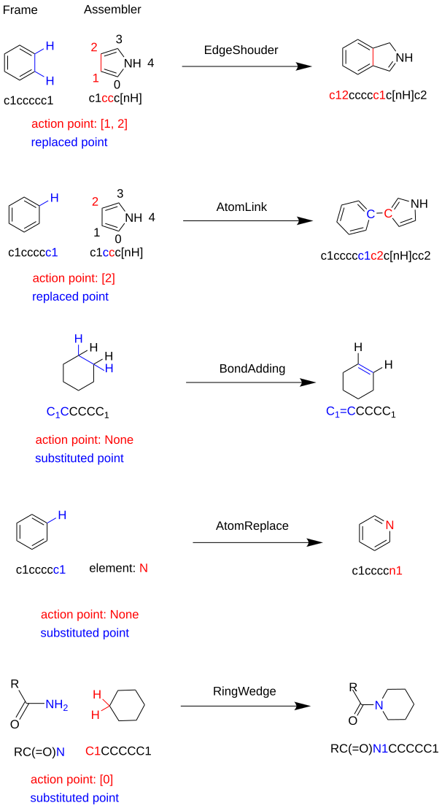
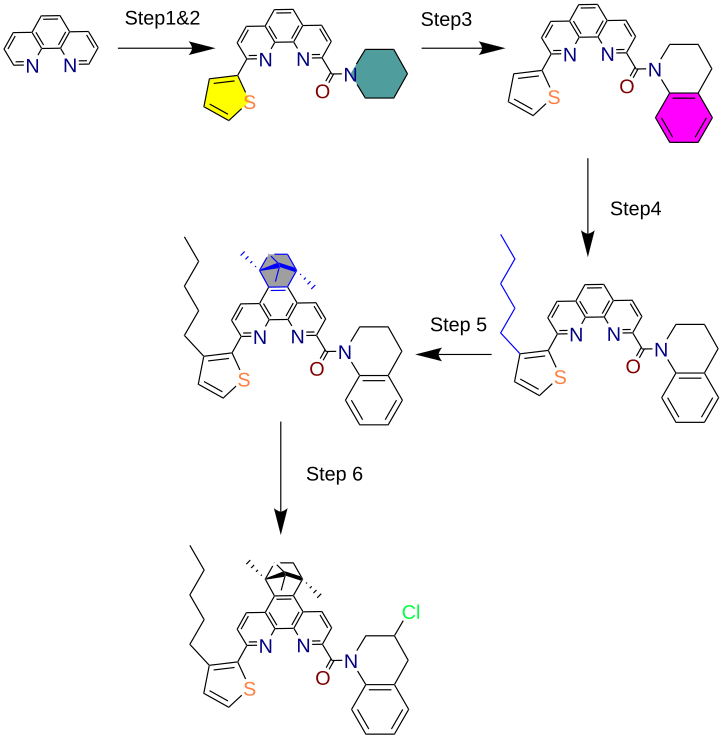

# Molecular assembly

`hotpot.cheminfo.operations.assembly` owns fragment transformations and finite
molecule enumeration. The eight classes are also available from `hotpot` and
`hotpot.cheminfo`; advanced generators and actions use the operation path.



## A first product

```python
import hotpot as hp

frame = hp.read_mol("C", "smi")
water = hp.read_mol("O", "smi")
products = hp.AtomLink(water, action_points=(0,)).graft(frame)
assert set(products) == {"CO"}
methanol = products["CO"]
assert [atom.implicit_hydrogens for atom in methanol.atoms] == [3, 1]
assert [atom.formal_charge for atom in methanol.atoms] == [0, 0]
assert [atom.implicit_hydrogens for atom in (frame.atoms[0], water.atoms[0])] == [4, 2]
```

`Fragment.graft(frame)` returns `dict[str, Molecule]`, keyed by product SMILES.
It searches working copies, leaves the input frame and configured fragment
unchanged, and retains one product per key. Direct advanced actions modify and
return the supplied parent molecule. Each built-in action is one factual
transaction: an error or interruption restores its complete parent state.

## Built-in transformations

| Class | Construction | Transformation |
| --- | --- | --- |
| `AtomLink` | `AtomLink(fragment, action_points=(index,))` | Replace one H on each selected capped site with a single bond. Searches C/N sites carrying H. |
| `AlkylGraft` | `AlkylGraft(capped_alkane)` | The same substitution at fragment Atom0; parent sites may be C/N/O. |
| `BondAdding` | `BondAdding()` | Increase a nonaromatic single/double bond by one order, consuming one H per endpoint. |
| `AtomReplace` | `AtomReplace(element)` | Replace a selected C/N/O element, preserve its other facts and complete only that site's H. Targets are N, O, Si and S; the existing heavy-bond and P/S-neighbour restrictions apply. |
| `EdgeShoulder` | `EdgeShoulder(fragment, action_points=(first, second))` | Replace two parent bond endpoints with the fragment anchors, transfer outside heavy bonds and complete anchor H. Deleted parent endpoints take their attached graph H with them. |
| `RingWedge` | `RingWedge(ring, action_points=(index,))` | Retain a parent terminal heavy atom and its external bond, replace the fragment's ring anchor with that atom, and complete its H. |

```python
import hotpot as hp

ethene = next(iter(hp.BondAdding().graft(hp.read_mol("CC", "smi")).values()))
assert sorted(atom.implicit_hydrogens for atom in ethene.atoms) == [2, 2]
ammonia = next(iter(hp.AtomReplace("N").graft(hp.read_mol("C", "smi")).values()))
assert ammonia.atoms[0].atomic_number == 7
assert ammonia.atoms[0].implicit_hydrogens == 3
```

Hydrogen counts require their representation convention. Existing ordinary
inferred/user counts are site totals; initial toolkit counts exclude graph H.
The actions capture coherent current inventory and consume it explicitly.
Changed product sites receive explicit site-total counts, with existing current
transport updated and source-H history preserved. Unrelated counts are retained.
No global import or generic add-H normalization occurs. Legacy materialized
imports may have lost graph/count overlap information and cannot be recovered
from producer codes or source history alone. Correct or explicitly redeclare
such an input before requesting an exact cap transformation.

Graph-H removal prefers ordinary H. A choice between distinct isotope products
requires a specified transformation. These operations do not choose retention,
inversion or E/Z outcomes: affected specified/uninterpreted stereo fails locally;
unaffected records are remapped. Element/scaffold completion retains
`no_implicit` and never invents charge, radical or tautomer choices. Inspect raw
H, graph adjacency and charge when checking products: a SMILES string alone
cannot establish their consistency. Generic inferred-plus-graph-H RDKit export
retains its separate historical count-projection limitation.

## Alkyl attachment isomers

```python
from hotpot.cheminfo.operations.assembly import alkyl_generator

alkyls = alkyl_generator(lengths=[1, 2, 3, 4])
assert [len(alkyls[n]) for n in (1, 2, 3, 4)] == [1, 1, 2, 4]
for n, assemblers in alkyls.items():
    for assembler in assemblers:
        assert len(assembler.frag.atoms) == n
        assert sum(atom.implicit_hydrogens for atom in assembler.frag.atoms) == 2 * n + 2
```

Each fragment is a capped alkane with attachment Atom0. Enumeration retains
attachment identity, including n-, sec-, iso- and tert-butyl. Grafting consumes
one fragment cap H; it does not insert an extra anchor carbon.

## Custom fragments and exclusions

```python
import hotpot as hp
from hotpot.cheminfo.operations.assembly import atom_link_atom_action

query = hp.Substructure()
query.add_atom(hp.QueryAtom(atomic_number={6}, has_hydrogen=lambda atom: atom.implicit_hydrogens > 0))
fragment = hp.Fragment(
    hp.read_mol("O", "smi"), hp.Searcher(query), [0], atom_link_atom_action,
)
assert set(fragment.graft(hp.read_mol("C", "smi"))) == {"CO"}
```

Pass a callable with signature `(mol, hit, frag, action_points) -> Molecule`;
string registration keys are internal and are not an action-resolution API.
Custom actions own their declared chemistry and error behavior. Configure
exclusions with `add_exclude_from_sub`, `add_exclude_from_mol` or
`add_exclude_from_smi`; a candidate touching an excluded atom is skipped.

## Factory and definitions

```python
import hotpot as hp

factory = hp.AssembleFactory(
    [hp.AtomLink(hp.read_mol("C", "smi"), (0,))], iter_step=2,
)
assert factory.make([hp.read_mol("C", "smi")]) == {"C", "CC", "CCC"}
```

`make(mol_iter)` returns the accumulated `set[str]`. `mp_make(mol_iter,
nproc=None, timeout=1800, batch_size=10)` expands only each epoch's new frontier
using bounded workers; it accepts molecules or SMILES. `timeout=0` disables the
per-batch time bound. Unknown worker failures and timeouts are visible errors,
not missing batches presented as complete results. Exceptions retain their type
where pickle permits and their original chained traceback text. Untransportable
exceptions fail explicitly. Only invocation-owned workers/channels are cleaned.

`max_running` stops after the accumulated result count exceeds the configured
cap; `None` disables the cap. `catch_path` saves accumulated SMILES, including
completed observations on an error, and `save_per_step` controls intermediate
save cadence. Inputs and failed batches remain attributable in diagnostics.
`mode`, `seed` and `sample_weights` are retained configuration fields but are
currently unused: both modes perform finite enumeration, not random sampling.

`load_default_assembler()` loads the sole packaged 26-definition resource
`data/fragment_template.json`. `init_with_default_assembler(...)` adds those
definitions to an optional caller collection. `load_assembler_file(path)` and
`load_assembler_contents(list_of_dicts)` accept the following schema illustration:

```json
[
  {"method": "AtomLink", "smiles": "O", "points": [[0]]},
  {"method": "EdgeShoulder", "smiles": "C=C", "points": [[0, 1]]},
  {"method": "AtomReplace", "elements": ["N", "O"]},
  {"method": "BondAdding"},
  {"method": "AlkylGraft", "link_length": [1, 2]},
  {"method": "RingWedge", "smiles": "C1CC1", "points": [[0]]}
]
```

Optional `ExStrct` supplies an exclusion SMILES. The packaged default contains
five method kinds; RingWedge is supported through caller definitions. Older
ChemData fragment/framework schemas are distinct and are not additional defaults.


