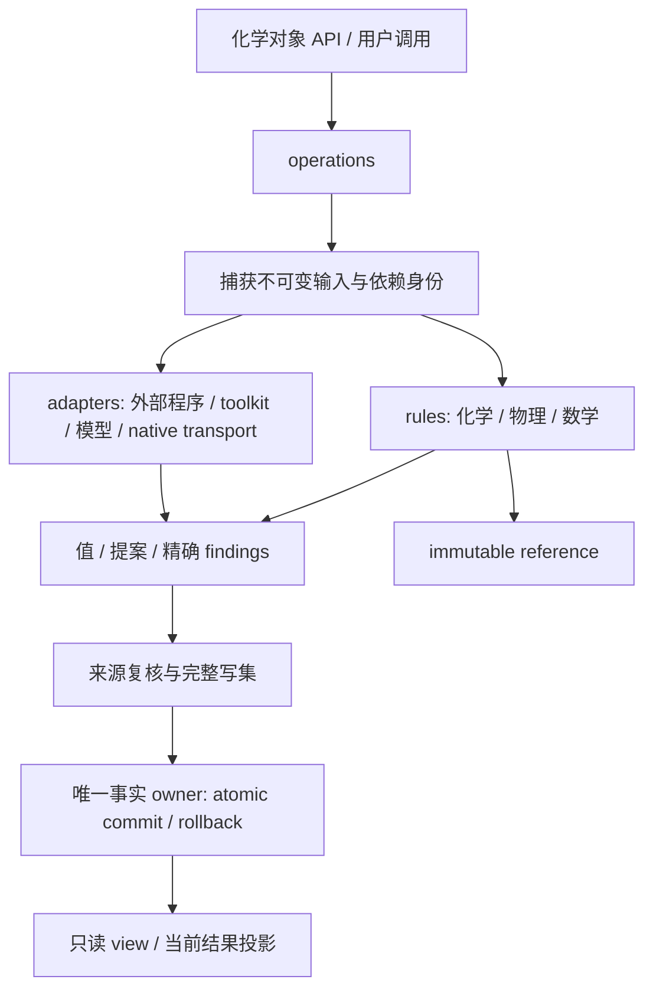

# Plan20 整体交付报告

2026-11-06 接口精修见[结果与转发层精简记录](stages/stage12/public-output-simplification/report.md)；
下列整体交付数据保留其原始快照，当前细化接口以关联 API 文档和精修证据为准。

报告日期：2026-11-05。当前产品提交：`2c2ef889abb6adcceba043b606da2e718dbea109`，分支
`experiment/plan20-kekulize-aromatic-protocol`，已推送到 GitHub。
本文覆盖 Stage0–12 主线、整合的 Plan12 要求，以及 Stage13–15 三条已批准支线。
完整组合业务基线为 `8785a06fca063a179976ca74d6bc8cb14bcce640`；本次核对发现并修复 D039/D040，
新增受影响源码和 CP311 安装包验证。模型、科学计算和全套矩阵沿用各自原始证据，未重标为本次新执行。

Plan20 已在**批准且明确限定的支持域内完成验收和交付**。交付的核心是唯一化学事实所有权、
可组合的规则与操作、可追溯的计算结果，以及批准支持域内的分子/晶体与数据转换能力。
同时保留已知芳香性缺陷、通用周期图表达限制、可用但变慢的路径和未执行的可选研究功能。
本次核对发现的 API 退休遗漏与 Gaussian 缺失值问题已按 D039/D040 完成有界修复和验证（见第7节）。
后文逐项给出支持边界，避免把阶段验收、测试计数或历史结果误读为普适科学保证。

| 阅读入口 | 内容 |
|---|---|
| [0. 哲学](#0-哲学) | 功能目标、事实与结果、科学判断、架构及实施取舍 |
| [1. 架构更新](#1-架构更新) | 分层、所有权、依赖、生命周期、native 与各阶段交付 |
| [2. 原有功能保留与取舍](#2-原有功能保留与取舍) | 保留、迁移、修复、直接删除及不兼容边界 |
| [3. 新增功能](#3-新增功能) | 事实接口、结果管理、PyG、Crystal 和精确空间操作 |
| [4. 性能](#4-性能) | 可比测量、完整业务成本、退化、设备和资源限制 |
| [5. 科学性校验](#5-科学性校验) | 化学判据、实际模型/后端、独立参照、版本和交付验证 |
| [6. 当前完整 API tree](#6-当前完整-api-tree) | 当前公开入口概览及完整树附件 |
| [7. 已知问题与未来改进](#7-已知问题与未来改进) | 当前风险、接受的限制、延期范围与建议顺序 |

本报告以[当前 goal](goal.md)、[实施计划](fact_rule_architecture_implementation_plan.md)、
[接口协议](chemical_type_interface_contract.md)和[当前接口修订](reviewed_interface_contracts.json)为解释依据。
Stage0–12 的[原始交付报告](stages/stage12/final-delivery/report.md)保留其历史范围；
Stage13–15 的[最终集成交付](stages/stage15/integration/report.md)补齐当前产品。
旧报告中的“后续阶段尚未开始”、31 个根导出、六参数 Crystal 或 schema1 PyG 等描述，均应按各自快照阅读。

## 0. 哲学

### 0.1 功能：让化学家灵活建模，并给出有边界的可用结果

Hotpot 为化学家提供在计算机上操作结构、表达研究假设、调用规则和计算、组织批量工作流的工具。
目标是具体方法和环境下的 **Not Error**：遵守声明的化学、几何和执行完整性约束，
提供有用且可解释的结果；研究对象的最终解释仍由化学家作出。
同一配体在晶体、溶液和孤立计算环境中的几何、配位关系或部分电荷可以不同。
库应保留方法与条件，不能仅凭一个启发式阈值宣称其中某个结构具有唯一正确性。

这决定了三个产品行为：

1. **保留输入事实。** 明确声明的电荷、H、键表示、立体和来源信息有自己的权威域。
   感知、默认值、后端准备或格式转换不能无声覆盖它们。
2. **返回所请求的值。** 数值、候选集、分布、轨迹均可以是正常结果。
   RDKit 方法得到的部分电荷仍可作为浮点数使用；解释来自方法、版本、条件和验证，
   无需给每个数值附加 `HIGH/LOW`、通用置信等级或虚构概率。
3. **明确问题并尽量局部化。** 有限、可归属但不理想的结果可保留并报告具体 finding。
   已知原因导致的个别失败保留在原始分母中；无关样本继续。
   非有限能量、非法后端电子态、映射损坏或事务完整性失败则按各自规则拒绝对应操作。

“有问题”与“如何处理”分别表达：finding 记录现象，warning、局部失败、用户指定 break
决定控制行为。异常终止适用于客观无法继续，或继续会破坏身份、映射、归属、共享状态等完整性的情况。
几何接近、穿刺、有限高能等观测的含义必须联系具体规则和域；它们不自动成为普适化学否定。

### 0.2 架构：事实只有一个 owner，计算通过明确操作发生

熟悉的 `Molecule`、`Atom`、`Bond` 和化学方法仍是日常入口。
内部将“存什么”“怎么算”“怎样调用和提交”“怎样与外部通信”分开：

- 事实载体持有结构、声明、当前表示及明确选定的结果；同一个事实不在 Atom、矩阵、toolkit 对象和缓存中各保存一份。
- 规则读取不可变、隔离的输入，产生值或提案；规则不修改活跃分子。
- 操作负责捕获、准备、调用、核对来源和完整提交，承担生命周期与失败回滚。
- adapter 负责已文档化的转换与外部执行；native 数值内核按语义归属到规则，工作流控制归属到操作。
- view 提供固定成员和来源上的观察，不成为第二份结构或事实 owner。

这里采用适合各领域的表示：Atom 适合列式事实表，SpaceGroup 适合不可变精确群值，
拓扑适合唯一索引，模型输入适合一次性张量。共同协议规定权限和生命周期，
无需每种对象共享一个万能基类、DTO、注册器或公开“规则句柄”接口。

### 0.3 互操作：尽量少丢信息的静默自动化

Hotpot 发起的 toolkit 往返保留原始 Hotpot 事实权威；外部原生对象首次导入时，
以该对象实际携带的信息和已登记的导入映射为准。
已知、确定的键类型或表示转换由带版本的规则安静完成，不增加无用标签。
未知或未映射的实质信息损失、原子关联错误和其他完整性问题需要精确诊断。
转换不能补回原本不存在的事实，也不能在载体脱离后重建已经丢失的来源关系。

因此，普通 PyG 导入不猜测 embedding 中的化学意义，CIF 缺少 Bond loop 时不自行感知键，
未知空间群也不默认当成 P1。部署模型的特征转化由模型板块持有，避免一般转换接口改变训练语义。

### 0.4 实施：化学语义优先，性能可用，验证匹配风险

本轮执行优先级是 **化学语义正确性 > 可接受性能 > 全版本适配**。
先建立 CP311 的实际业务证据，再补齐本次交付所声明的 CP310–CP314 范围。
不同业务重要性不同：

| 优先级 | 范围 | 本轮原则 |
|---|---|---|
| 1–2 | Molecule/Atom/Bond 表示、转换；图、芳香、立体、价态和 H | 必须；事实和语义是其他功能的上游 |
| 3 | CBond → FF → GFN-FF → xTB，含几何门控 | 必须；验证真实交接、状态和局部失败 |
| 4 | MCA | 必须；验证实际推理、行/site 关联、结果附着和当前性 |
| 5–6 | I/O；RDKit/Open Babel 通信 | 尽量完整；被前四项依赖的路径仍为必须 |
| 7 | 其他独立第三方功能 | 可明确延期并报告，不能推断已执行 |
| 追加范围 | Stage14 通用 PyG、Stage15 Crystal | 按单独批准的域和接口完成并纳入最终集成 |

最小防护原则允许明确的域检查、映射契约和事务回滚，避免为主观猜测的故障层层增加兜底。
已知有界缺陷可以按文档规则处理；未知原因应暴露供诊断，不以宽泛 `try/except`、默认值或隐藏重试制造结果。

小步 Git 用于交付可回退的业务变化，相关文档、测试和证据随业务提交。
未变更且仍适用的证据按影响域复用；普通小改动不重复全套计算。
性能退化若有解释、仍能完成代表性任务，可以明确接受并进入后续工作。
OOM、无界增长或必须批次不能完成始终是可靠性问题。
SHA 用于归属和传输校验；化学合理性、数值近似和随机波动采用各自判据。

## 1. 架构更新

### 1.1 从混合中心对象到按职责分层

原 `core.py` 及周边混合模块同时承担成员、数值存储、化学计算、外部转换、缓存和工作流。
本轮把这些职责迁入单一、可定位的所有者，普通对象方法保留为薄入口。

```text
hotpot/
├── cheminfo/
│   ├── structure/                 事实载体、结果/快照契约、身份、提交和生命周期
│   ├── views/                     几何/环/拓扑/原子对等来源绑定视图
│   ├── rules/
│   │   ├── chemistry/             H、芳香/键序、立体、状态、搜索、组装规则
│   │   ├── physics/               力场策略、物理数值规则及对应 native 源码
│   │   └── mathematics/           CSR 图、几何、精确仿射/晶胞与数值内核
│   ├── operations/                准备、查询、调用、来源检查、事务提交和工作流
│   ├── adapters/                  toolkit、I/O、进程、资源、模型、ABI/打包边界
│   ├── reference/                 不可变参考表与资源
│   ├── rdWrappers/                保留的独立 RDKit native 组件
│   ├── obWrappers/                保留的独立 Open Babel native 组件
│   └── stereo.py                  显式公开 facade；定义仍只有一处
├── commands/                      CLI 的唯一命令 owner
└── pipeline/                      保留的通用工作流基础设施
```



package `__init__` 向下显式导出；内部实现从实际 owner 导入，避免反向通过大 facade 取依赖。
需要的 toolkit 按入口惰性加载，资源通过包资源机制定位。
精确值构造可直接复用已批准的纯数学不变量；adapter 可初始化自己新创建的输出对象。
这类明确边界仍禁止修改权威源载体或外来缓冲区。

### 1.2 事实分层和唯一所有权

| 事实层/职责 | 当前 owner 与语义 | 消除的重复或歧义 |
|---|---|---|
| P0 成员/拓扑 | Molecule 的有序 Atom、完整有序 Bond；不可复用的局部 UID；唯一 `_topology_index` | 行号、来源 id、Python identity 与持久成员身份不再混同 |
| Atom 数值事实 | 一个 `_AtomFactTable`，类型化列/数值块；标量与批量入口映射到同一份数据 | Atom 附加字典、矩阵、坐标块各保存一份当前值 |
| P1 显式声明 | 净电荷、自旋、显式 H/形式电荷来源、当前坐标及独立源帧 | 明确输入与默认显示/推断结果混同 |
| P2 当前表示 | 完整耦合键表示、H/芳香等规则结果及有限有效性元数据 | 局部 setter 顺序隐式拼装化学状态 |
| P3 选定科学结果 | typed MCA、部分电荷、生成/优化构象等；内容与来源各有契约 | `properties['mca']`、Atom 标量和 site 字典各持一套预测 |
| P4 view / finding | 固定成员/来源的几何、环、pair 等观察；finding 由相关规则产生 | 活跃载体上长期保留环、角、二面角和派生 pair 缓存 |
| A0 可重建加速 | 唯一拓扑索引及任务内数值结构 | 多份持久图、递归 Molecule-keyed SMARTS 缓存 |
| 约束 | 一个 Molecule-owned constraint set | Angle/Torsion/Bond/Atom 各保存独立约束真相 |
| 立体 | canonical records/schema 与来源 ledger | 当前全量 payload 与 Atom/Bond 事实重复保存 |
| Crystal | 一个有方向的行基矩阵和与 Molecule 的配对关联；SpaceGroup 独立持群/setting | 六参数、矩阵、toolkit cell 和 Crystal 层 operator 列表并存为权威 |

来源、presence 与 currentness 是解释事实所需的不同维度。
明确零、缺失、需要重算和真正冲突有不同含义；兼容的芳香/Kekulé 投影不因编码不同而成为冲突。
来源 id 可变、当前 row 会随重排变化；私有 Atom/Bond UID 在同一 Molecule 生命周期内单调分配且不复用。

### 1.3 依赖、结果和变更生命周期

典型写入经过“编码/完整校验 → 一次安装 → 标记受影响依赖”。
跨字段操作使用统一事务，失败恢复成员、表、约束、结果和映射所需的原状。
耗时调用先捕获必要输入，提交前检查对象归属和依赖内容，防止旧计算覆盖新事实。

当前性采用有限的事实组依赖，包含 `CURRENT`、`NEEDS_RECALC`、`ABSENT`、`UNRESOLVED`、`CONFLICT`。
拓扑传播只沿唯一索引在必要域展开；普通字段写入不立即运行所有化学计算。
getter 可以触发已声明的局部纯准备，不隐式下载模型、启动 GPU 或外部优化。

已经返回的不可变结果是历史观测；源对象改变时其内容保持不变。
“当前选定的结果”则由 owner 检查依赖，失效后不能作为当前值读取。
copy、components、merge、pickle、成员重排和显式选择分别遵守各自映射/归属契约。
当前坐标、导入源帧、生成构象集合和选中帧因此具有不同职责。

### 1.4 native、模型和外部程序的边界

native 按实现的意义分层：纯图/几何/物理数值在 rules；会话、优化和轨迹控制在 operations；
跨 Python/C++、ABI 和外部对象的编码在 adapters。
共享 CSR Graph 与字段选择式 `NativeMoleculeBuffers` 只构造所需数据，后者是任务运输值。

`rdWrappers` 与 `obWrappers` 保留独立组件接口，Hotpot 通过 adapter 调用它们的同一套实现。
MCA 仍采用已选定的 Python–RDKit 生产路线；模型权重、部署特征编码和站点识别按原契约保留。
GFN-FF/xTB 等外部进程的可执行文件、请求、状态投影和运行产物有各自归属，
不把进程状态、方法选择和科学置信度压成一个通用标签。

### 1.5 各阶段交付总览

| 阶段 | 交付内容 | 最终状态与记录 |
|---|---|---|
| 0 | 唯一主线、Plan17/Plan20 路线界定 | [路线登记](stages/stage00/README.md)；未把后续 native MCA 算法并入本轮 |
| 1 | 可执行基线、API/消费者、采样与版本验证范围 | [基线与接口](stages/stage01/README.md)，执行基线 `e6082f5` |
| 2 | 经确认的占位/过时实现退休 | [删除证据](stages/stage02/README.md) |
| 3 | Atom 唯一事实表、来源、批量更新、builder、native Undo | [报告](stages/stage03/report.md) |
| 4 | 纯数学、来源绑定 view、约束和 pair 值 | [报告](stages/stage04/report.md) |
| 5 | 只读化学规则、有限 H/芳香依赖和默认值语义 | [报告](stages/stage05/report.md) |
| 6 | 立体定义、规则与操作拆分；完整验证与原子提交 | [阶段记录](stages/stage06/README.md) |
| 7A–E | adapter/I/O；完整拓扑；MCA/电荷结果；坐标帧；canonical stereo | [完成记录](stages/stage07/completion_20261103.json) |
| 8A–E | 科学状态、力场、搜索、模型/构象、原子组装 | [阶段索引](stages/stage08/README.md) |
| 9 | 剩余 query/消费者迁移、Core 物理删除和集合 | [阶段索引](stages/stage09/README.md) |
| 10 | native/build/package 迁移与最终 ABI/SDK 证据 | [阶段索引](stages/stage10/README.md) |
| 11 | immutable reference、资源、命令、旧 asset/query owner 退休 | [阶段索引](stages/stage11/README.md) |
| 12 | H 消费者、科学/模型/转换修复、全局验证及主范围验收 | [主范围报告](stages/stage12/final-delivery/report.md)，`B_exp=5a7b1939` |
| 13 | 单一芳香/Kekulé 算法的私有连接协议实验 | [集成报告](stages/stage13/integration/report.md)；`D_exp=5dc0443`、`I_exp=cc9470e` |
| 14 | 通用 `to_pyg/from_pyg`、可编辑 Data/Batch、Crystal schema2 与真实 CUDA 训练运输 | [当前报告](stages/stage14/crystal/validation/report.md) |
| 15 | 精确 SpaceGroup/SymmUnit、放置/扩胞、周期几何/拓扑、CIF | [完整交付](stages/stage15/domain/validation/persistence_report.md) |
| 最终集成 | Stage13/14/15 与主线合并，源码/default/五 ABI 安装及文档交付 | [最终报告](stages/stage15/integration/report.md)，组合基线 `8785a06f` |
| 交付核对后修复 | 通用 mutation 入口退休及 Gaussian 可空热化学值 | [D039/D040 关闭记录](stages/stage12/final-delivery/validation/postdelivery-interface-cleanup.json)，当前产品 `2c2ef889` |

### 1.6 体量和类型预算的实际结果

当前统计为 **526 个 Python 文件、776 个类定义、355 个 dataclass、8 个直接加 4 个泛型 Protocol、2 个 TypedDict**。
重构前全产品口径为 782 类、347 dataclass、13 个历史 Protocol、3 个 TypedDict。
Stage0–12 快照为 505 Python 文件/771 类/355 dataclass；追加支线增加 21 文件/5 类。
因此可以确认职责和事实所有权收敛，但不能声称“所有数据类型都减少了”：dataclass 净增 8 个。

历史迁移账覆盖 **43 个家族、384 个类型**：342 迁移、24 保留、13 明确删除、5 个历史 Protocol 已不存在。
移动类、替换成 dict、改名或将 wrapper 排出分母均不计作合并收益。
具体 D04/D05/FF-CLI 各删除 1 个 dataclass，D07 删除 2 个；批准保留的不同域合同不虚记精简。
详见[对象预算](data_object_budget.json)、[对象审计](data_object_scope_audit.md)及
[主范围 API/迁移登记](stages/stage12/final-delivery/validation/api-reconciliation.json)。

## 2. 原有功能保留与取舍

### 2.1 保留的业务能力及其当前归属

| 能力 | 当前交付 | 保留条件或显式变化 |
|---|---|---|
| Molecule/Atom/Bond 创建、成员/端点、复制、拆分、合并 | `structure` + named operations | 普通化学对象入口保留，身份/来源/完整写集更明确 |
| 标量原子属性与矩阵 | 同一事实表；完整 19 列 `atom_matrix` | 直接替换旧 `atom_attr_matrix`，不留旧名别名 |
| 完整键集合、金属/共价选择 | 一个完整有序 Bond 集合，操作内选择 | H 工作副本保留原 Bond 前缀后追加 H，明确替代旧隐藏/恢复顺序 |
| 图、路径、环、RI 子结构搜索、SMARTS | sole topology/CSR + 纯规则 + 查询操作 | 保留匹配/截断和有约定的枚举次序；已知芳香限制仍存在 |
| H、价态、芳香/Kekulé | 统一 H 计数和完整表示赋值 | 推断与明确声明分开；合法等价表示不当作冲突 |
| 立体传输、校验、赋值、对齐及配位语义 | `structure.stereo` / rules / operations / facade | canonical/current 与 source ledger 分开；修复实际坐标消费者的立体丢失 |
| 几何、环、角、二面角和原子对 | task-produced read-only views | 不保留旧持久 view 缓存；约束投影到同一个 owner |
| 部分电荷 | 命名计算/完整集合赋值；只读当前投影 | 与形式电荷、分子净电荷分开；缺失不是明确零 |
| 构象、3D 建模、优化、热力学 | 薄对象方法 + operations + 唯一 backend | 保留作用和已审方法；当前/源/生成坐标生命周期拆开 |
| CBond | 模型定制特征、路径/结构分布、CLI/pipeline | 保留 logits、概率、站点/donor 和原模型；不将模型概率改成通用置信等级 |
| FF → GFN-FF → xTB | 明确后端投影、阶段交接、monitor、有限失败保留 | 真实后端/失败分母和最后有限几何都保留 |
| MCA CPU/GPU/路由/rolling | 原生产算法与模型、atom/site 映射、typed attachment | 原低于 256 site 的 GPU→CPU 路由规则等仍按模型契约运行 |
| 读写和转换 | `operations.io/conversion` + toolkit/I/O adapters | 已登记格式/损失边界按合同处理；不把序列化成功当科学验证 |
| 组装和工厂 | declared transformation + atomic assembly | H、charge、stereo、映射及失败回滚一起处理 |
| MolBundle/数据集导出 | sole collection owner + PyG adapter | 名称、默认 member ordinal 和覆盖规则按已审合同保留 |
| CLI、参考表和属性查询 | `commands` / `reference` / 查询 operation | 已有命令名/参数保留；可选研究执行另有证据范围 |
| 独立 rdWrappers/obWrappers | 原独立组件仍可使用 | Hotpot 调用同一 native 实现，不复制为第二套后端 |

### 2.2 明确删除、直接迁移和不兼容边界

| 旧入口/状态 | 处理与理由 | 使用影响 |
|---|---|---|
| `cheminfo/core.py` 及旧混合 geometry/graph/calculator/forcefields/search/AImodels 等 owner | 物理迁移并删除旧实现/路径 | 直接使用旧实现路径的调用者需迁移；没有兼容 shim 树 |
| `core_func.pyx`、旧 `_clib`、废弃 parser/占位 Calculator | 经实际依赖/构建审计退休 | 不为不可执行占位保留公开表面 |
| 通用属性批量写入 | Atom 旧通用入口退休；本次将残留 `Molecule.setattr(**attrs)` 及 Gaussian 消费者一起迁移 | D039 已关闭；通过命名事实/批量入口写入，orbital energies 等报告值从 `GaussOut.parse()` 查询 |
| hide/recover hidden Bond 系列 | 完整拓扑 + 私有任务内 selection | 不再靠临时删键/恢复重建事实 |
| Ring/JointRing 等 view 的变更方法、持久 angle/torsion/ring/pair 缓存 | 只读 view，写入从 Molecule 操作发起 | 读取和变更的边界清晰；某些重复查询有已接受成本 |
| 持久 `_obmol`、`_row2idx`、递归 Molecule-keyed SMARTS cache | 新鲜转换对象、sole index、局部复用 | 外部对象不是当前化学事实的第二 owner |
| 原始 `_mca`/site 字典/`properties['mca']`、raw partial-charge scalar owner | 一个 typed selected result 及其投影 | `properties` 保留用户 annotation，用于结果的旧私有访问需迁移 |
| 通用 confidence 字段/enum 和成功评级包裹 | 普通结果 + 必要的域 finding/内部归属 | 方法和适用域写在文档、报告及结果 owner；不附虚构等级 |
| `to_pyg_data`、旧集合 prefix、schema1 loader | 当前 `to_pyg/from_pyg`、schema2 直接切换 | 按用户决定，不提供旧版输出或别名 |
| 六参数 Crystal 权威、`obcell` 式载体内 toolkit 状态 | 一个 oriented basis；外部对象在 adapter 新建 | 六个参数仍可读/经批准 setter 更新；方向信息有唯一存储 |
| package wildcard export、`package_root`、全局 tempdir、导入时改 `sys.path` | 显式导出、包资源和操作级临时文件 | 导入无需初始化所有 toolkit；内部路径按 owner 定位 |
| 历史 private pickle/schema 兼容载入 | 支持当前版本生命周期；不增加历史 loader | 更新环境时使用当前已批准的结构格式/迁移边界 |

### 2.3 实际修复与保留的算法边界

本轮迁移暴露并修复了真实化学消费者问题，包括：

- H 表示统一为 site target `T`、实际图上 H `E`、剩余待物化 `R=max(T−E,0)`，
  让 toolkit、native、构象、模型、搜索、组装和状态投影读取同一物理库存。
- 中性酸在共享 SMILES/MOL2 往返中的 H/charge 丢失，改为使用已准备 OBMol 的直接序列化。
- 声明立体未到达 native 3D 几何消费者的问题，以及显式物化 H 后合法 RDKit stereo export 的关联问题。
- 完整 H 适用域、明确 H0 的状态捕获、P 位点普通优化结果角色等业务遗漏。
- 本次核对补齐通用 mutation 退休，并区分 Gaussian 未计算热化学值和真实零；不新增任意载体附加结果。

修复用独立化学/坐标参照和真实部署路径证明；原错误输出、失败尝试和仍未通过质量门控的结果保留。
Stage13 只改变现有芳香规则的私有连接，未引入第二个芳香算法。
Plan17 的 native MCA/MMFF/UFF 算法闭合和 Plan21 MetalCluster runtime 没有借此次重构被宣称完成。

## 3. 新增功能

### 3.1 统一事实与结果接口

- **受控批量原子写入与完整矩阵。** `Molecule.updata_atoms` 与标量入口共用声明和提交；
  `atom_matrix` 是完整 19 列快照。方法名中的既有拼写以实际 API 为准。
- **来源/presence/currentness。** 缺失、明确零、用户声明、推断表示和失效结果能按对应合同区分。
- **一次性 factual builder 与事务。** 导入、copy/remap、完整结果和坐标提交使用同一基础设施，
  降低逐字段 setter 导致半更新的风险。
- **typed MCA/部分电荷及构象结果。** 当前投影检查依赖，已返回历史结果稳定；getter 不暗中启动昂贵计算。
- **科学状态工作流。** 分子事实、候选状态、规则迹线与执行后端投影各有明确角色；
  科学 `2S` 与 backend UHF 分开，默认 UHF0 不等于已解析科学单重态。

这些能力主要增加可组合性、当前性和可靠提交，并不自动提高既有模型的预测精度。

### 3.2 通用 Molecule/Crystal ↔ PyG

公开入口是 `to_pyg()` 和 `from_pyg(data, field_map=None)`；返回普通、可编辑的 PyG `Data`。
当前 schema 为 `hotpot.molecule/2`，适用于普通 DataLoader、Batch、设备搬运和训练。

| 场景 | 当前行为 |
|---|---|
| 提供有用训练信息 | node/edge、坐标、presence/source、约束、立体/H/isotope 和可携带科学观测；Crystal 增加 cell、group、image、occupancy 等 |
| tensor 训练前处理/编辑 | 当前 tensor 事实有权威；原子/键重排需要同步 key 与关联索引 |
| 历史观测导入 | 作为可归属的历史 annotation；不恢复为当前选定 MCA/部分电荷结果 |
| 外来 Data | 必须 `field_map`，明确列选择、单位和单边/paired-edge 约定；不猜 embedding |
| 未知/缺失 | 不补造 H、charge、bond、group 或 image；unknown group 与 P1、standalone Crystal 与 attached empty Molecule 均可区分 |
| 不支持的完整表达 | 明确局部拒绝；不合并边、不偷偷扩胞、不用任意对象 pickle 兜底 |
| 成熟部署模型 | CBond/MCA 的定制化特征入口由模型模块持有；一般 Data schema 不改变其训练输入 |

已有真实 CUDA DataLoader、32-step 合成训练和结构重建验证，范围是一般数据运输与使用。
这不增加 CBond/MCA 的精度声明。用法和当前字段见[包内 PyG 指南](../../hotpot/cheminfo/operations/pyg.md)。

### 3.3 Crystal、SpaceGroup 与 SymmUnit

`Crystal` 持有有方向的晶胞行基矩阵，并关联一个仍独立持有化学事实的 Molecule。
约定为 `cartesian = fractional @ crystal.matrix`，长度 Å、角度 degree。
`matrix` 返回独立数组，六参数是投影；paired association 由单一生命周期维护。

`SpaceGroup` 是不可变的群、setting/origin 和平移晶格 owner。
`Crystal.symm_units` 为只读派生访问，未知群保持 `None`。
已提供 230 种普通三维空间群各一个明确参考 setting/origin 的完整目录：
4,425 个常规晶胞有限代表元，跨该固定目录按精确 `R,t` 去重得到 786 个字面值。
786 是该坐标约定下的统计量，不是 SymmUnit 子类数或一套通用“基元”。
任意整数晶格平移仍保留，因此完整空间群的操作集合无限。

`SymmUnit` 是一个完整精确仿射群元素 `{R|t}`，分数列坐标作用为 `R*f+t`。
支持 `compose`/`inverse`/`power` 与 `@`/`~`/整数 `**`；
`g @ h` 表示先 h 后 g。运算保留整数平移，`reduce_to_cell` 才分离晶胞代表元与 carry。
群上下文/setting 不同的操作需要明确合法重绑定；单个有限阶旋转的 screw/glide 仿射元素未必有限阶。

| 能力 | 交付行为与限制 |
|---|---|
| `operate(g)` | 返回一个新的变换后 placement；保留源对象、当前 cell/group |
| `unit_cell()` | 复制填充当前内容；发布 active P1，来源群和 image maps 保留为历史 |
| `expand((nx,ny,nz))` | 复制扩胞；不对已生成内容再次应用历史群 |
| `unit_molecules()` | 按实际 image 图和一致零电压 lift 提取有限单元；无限周期分量有精确不可用原因 |
| `same_molecule_candidates(...)` | 同一放置下完整坐标重叠 + 化学/位点双射；单独两原子重合不授权去重 |
| `molecular_symmetry(...)` | 查支持操作对固定有限单元的稳定性，保留其真实 placement |
| `geometry_findings(...)` | 倾斜晶胞的度量有界邻居、近接/重合、周期 image、环/键穿刺等 |
| `linking_number(...)` | 显式有向有限闭环的整数链接数及可用性；非零为观测，零不证明不缠绕 |
| `from_cif/to_cif` | 纯 Hotpot 化学/群语义，Gemmi 仅解析/写出 CIF 语法；保持方向和历史上下文的闭合扩展 |

每条 Bond 的有向整数 image 与完整 Bond 次序一一对应；明确 `(0,0,0)` 与未知 `None` 分开。
过近、同分子候选、链接等工具提供几何/拓扑分析，不自动判定晶体实验合理性、修复、去重或选 disorder。
Crystal 路径不调用 Open Babel、RDKit 或 CCDC Python API。
CIF 仅在该入口需要 `crystal` extra；当前约束为 `gemmi>=0.7.5,<0.8`。
方法、数值容差及实例见[Crystal 指南](../../hotpot/cheminfo/operations/crystal.md)。

### 3.4 组合后的实际使用域

最终集成有直接执行的组合 fixture：芳香赋值 → 普通 Data 编辑/重排 → 新 Crystal → 扩胞 → 当前表示准备。
检查 H/键、占有率、几何、历史结果归属和未知 image 局部拒绝，避免支线各自通过却在拼接处丢信息。
标准 I/O、PyG 与 CIF 是不同运输合同：CIF 不保存任意 Python 会话或选定 MCA 附着；
一般 Data 导入也不“复活”当前计算结果。当前版本完整对象生命周期由已审 pickle/copy/remap 路径承担。

## 4. 性能

### 4.1 比较口径和总判断

性能同时存在明显改善和明显退化，**没有足够依据给出一个“Plan20 全局加速倍数”**。
完整的 [62 项 CPU 表、GPU 与资源细节](delivery_evidence.md#重构前后性能保留改善退化和不可比项)
和[机器证据图](delivery_evidence_graph.json)保留全部原始分母和不利结果。

主要前后比较的端点是 `e6082f5 → 16b864f` 的冻结快照。
后续立体消费者修复、Crystal/PyG 和最终组合具有另行验证；这些旧成本不能重标为最终 Git 的精确新测量。
62 项 CPU 工作负载对应 124 次一次性 worker 调用，双方各 595 个计时样本，失败为零。
其中 57 项完整化学工作可比；3 项 clean-H read 的信息量和 2 项 MCA 输出元数据不同，
仍保留原始数值，但不用于完整输出相等或全局速度结论。

下表均为一次冻结 invocation 的中位数，可能包含多次 public call。
比率为 candidate/baseline，低于 1 表示本次测量更快；不能忽略 loops 将批次成本误写成单次成本。

| 工作（冻结任务） | Baseline ms | Candidate ms | C/B | 解释 |
|---|---:|---:|---:|---|
| 冷导入 1 次 | 896.948 | 555.310 | 0.619 | 导入开销改善 |
| 空 Molecule 构造 1,000 次 | 4.101 | 72.400 | 17.655 | 单个约 0.0724 ms；相对退化很大，绝对开销仍小 |
| 256 原子构造，5 次 | 127.982 | 187.396 | 1.464 | 单次约 37.479 ms |
| 256 原子 scalar-read，20 次 | 6.978 | 6.548 | 0.938 | 该冻结读取工作局部改善 |
| 256 原子 scalar-write，20 次 | 2.178 | 3.866 | 1.775 | 受控写/依赖维护有额外成本 |
| 256 原子 batch-facts，20 次 | 2.006 | 1.043 | 0.520 | 批量入口改善 |
| 256 原子坐标工作，20 次 | 28.544 | 2.172 | 0.076 | 唯一连续坐标投影改善 |
| 256×5 选字段矩阵，20 次 | 20.127 | 0.176 | 0.0087 | 是冻结的 5 列任务，不能称为全部 19 列导出时长 |
| 256 原子 native export，20 次 | 19.351 | 1.546 | 0.0799 | 字段选择式运输改善 |
| 256 原子插入/删除，20 次 | 8.713 | 30.939 | 3.551 | 成员、映射和失效维护有退化 |
| 256 原子 MCA 投影，20 次 | 0.774 | 4.085 | 5.280 | 结果当前性/投影的热点候选 |
| 256 原子 dirty-H write/read，20 次 | 40.764 | 389.230 | 9.548 | 每次约 19.462 ms；保留显著退化 |
| graph/search/geometry 任务，20 次 | 10.581 | 34.853 | 3.294 | 该组合任务变慢 |
| geometry screening，100 次 | 7.390 | 6.987 | 0.945 | 该数值筛查工作局部改善 |
| toolkit 转换任务，20 次 | 11.958 | 84.695 | 7.083 | 每次约 4.235 ms，原子/化学信息不减量 |
| 实际乙醇构建 + UFF 工作流，1 次 | 967.961 | 780.187 | 0.806 | 仅该方法、预算和 fixture 的完整工作 |

来源：[CPU 结果](stages/stage12/final-delivery/validation/final-cpu-performance.json)。
表中“写/依赖/归属”解释的是涉及的工作，不是已经完成逐项 profiler 因果归因。
各置信区间、样本、loops 与不可比原因均保留在完整表中。

### 4.2 模型实际成本

| 真实工作 | Baseline s | Candidate s | C/B | 实际设备与限制 |
|---|---:|---:|---:|---|
| MCA small-call fallback，8 molecules | 2.4140 | 2.6059 | 1.079 | 走 CPU，未启动 GPU |
| MCA，512 molecules / 768 sites / 2,176 atom predictions | 2.6116 | 4.8449 | 1.855 | 1 个实际推理 GPU |
| MCA，512 molecules，4 initialized sessions | 2.3174 | 4.6539 | 2.008 | 这个成本 fixture 只有 2 张卡实际推理 |
| CBond，20 CUDA calls | 0.05565 | 0.05630 | 1.012 | 保留全部实际工作和不利样本 |

每项 1 warmup + 3 计时样本，失败/无输出为零；来源为
[GPU 成本记录](stages/stage12/final-delivery/validation/final-gpu-performance.json)。
四卡功能复测确有四张卡计算，属于独立功能证据；不能把它当作上表四卡扩展性测量。
原酸元数据问题也限制了完整输出等价声明，不能只比较 work counters 就认定化学输出全同。

硬件为共享机器，GPU0/3 曾有其他约 13 GB 常驻进程；频率、负载和可用显存发生波动。
设备采样时每卡至少约 33,185 MiB 空闲，仍不等于独占或恒定状态。
这些数值支持本次可用成本处置，不能推出理想 GPU 吞吐、线性扩展或稳定的全局速率。

### 4.3 新完整能力和资源观察

| 业务/机制 | 实测 | 解释范围 |
|---|---|---|
| 完整 19 列、N=4,096 的投影 | 72.191 ms/read | 新机制 current-only；与前表 5 列快照不同，无 B0 比率 |
| 完整 256C / 两帧 SDF 写出 | 32.328 ms/call；总计 581 calls / 1,162 records | 真正持久化且独立读回，包含完整帧 |
| 独立 320-write / 640-frame 资源窗口 | Python tracked +48,321 B；RSS +1,081,344 B；峰值 152,969,216 B | 17 个 checkpoint；含观察器/输出开销；历史小步内存归因仍未确定 |
| 通用 PyG：mixed16 / 总 32 sites | 60.302 ms | 完整 export → Batch → CPU/unbatch → fresh import |
| 通用 PyG：4×128-site Crystal | 66.888 ms | 同上，包含精确晶体上下文 |
| 通用 PyG：generated 128-site Crystal | 201.868 ms | 同上，保留生成来源/context |
| 真实 468-site CIF read/write/read | 80.304 ms | 完整公开往返；read 18.893、write 17.999 ms |
| Crystal sparse 1,024-site geometry query | 1,861.171 ms | 捕获、准备、匹配、surface/link 的完整查询；不是稠密网络保证 |
| finite-link query，两环各 4 / 8 / 16 顶点 | 13.089 / 49.049 / 189.001 ms | 精确成对工作呈二次增长；大闭环吞吐仍是优化空间 |

来源：[新机制](stages/stage12/final-delivery/validation/final-new-mechanism-cost.json)、
[SDF](stages/stage12/final-delivery/validation/final-sdf-write-resources.json)、
[PyG](stages/stage14/crystal/validation/report.md)、
[CIF](stages/stage15/domain/validation/persistence_report.md)、
[geometry](stages/stage15/domain/validation/geometry_report.md)、
[linking](stages/stage15/domain/validation/linking_report.md)。

Stage14 三项分别为 1 warmup、5 次计时、1 次独立内存观察。
tracemalloc 没有覆盖全部 Torch/native 分配，RSS 为同一进程累计值。
稀疏几何查询仍可能随稠密输出或倾斜晶胞的大 cutoff 枚举较多 image。
SDF 的有限观察窗口不能证明任意批量无泄漏；D004 保留了未明的历史归因。
MCA rolling 的预算是整分子接纳前阈值：实际峰值 8,195 超过名义 8,192，
resident 10,241 低于 32,768，最后 credits 清空；它不是严格的接纳后 hard cap。

### 4.4 实验协议、测试成本和后续优化选择

Stage13 原始配对保留 benzene `1.0283×`、non-aromatic `1.2021×` 不利中位数；
其 bootstrap 95% 区间分别为 `0.9886–1.0653`、`0.7502–1.6501`，方向不确定。
20 分子 explicit/lazy 完整工作原为 117.291/189.620 ms。
后续载体发生变化，这些仍是原实验成本，不能称为最终组合的精确当前时长。

测试工具的成本单独记录：共同执行样本 candidate 中位数 230.868 s，
但逻辑/物理 population 和合同不同，无法作为成功的全局提速比。
原五版本成本共 60 次尝试，30 次 candidate 因旧 reference checker 失败；
失败尝试不能用于“成功套件耗时”对比。后来修正的真实 CBond case 有独立五 ABI 通过证据。
新增 3,183-node 选集中每次 3,169 pass / 14 tier skip，中位数 121.525 s、
p95 122.502 s、观察 RSS 688.621 MiB，也是单独快照。

优化应先针对用户实际完整批次，再选择空构造、成员变化、dirty-H、转换和结果投影热点。
保留原始工作、输入、结果信息和失败分母；不以减少化学工作换取更好计时。
已接受的性能问题有明确重开条件，见第7节和统一问题索引。

## 5. 科学性校验

### 5.1 校验标准：独立化学判据、方法条件和实际业务输出

本轮校验同时考虑规则的声明域、输出的可用性和程序的控制行为。
历史输出是重要参照；独立手算事实、正反/边界 fixture、坐标 oracle 和允许变化的变换关系提供额外依据。
两端共享同一实现的 round trip、SHA 相同或大量测试通过均不能单独证明化学语义。

| 判据 | 具体标准/参照 | 不合规时的含义与处理 |
|---|---|---|
| 身份和映射 | 同一化学边界的成员、H/isotope、图和 atom/site 对应；重排显式 remap | 映射/归属损坏为局部完整性失败，不能给出错误行关联 |
| 电荷 | 完整证据时 `Q=Σq_atom=ΣQ_component`；explicit 0 与 unknown 分开 | 冲突精确报告；缺失不猜中性；合法声明变换按允许变化检查 |
| H 库存 | `T` site target、`E` graph H、`R=max(T−E,0)`；新 toolkit 输入 `T=E+R` | 保留 source/current；不把缺失或显示 0 冒充已知库存 |
| Lewis 适用域 | 非 H site 的 total-H 必须完整 | 不完整时 `PROVIDER-001.INCOMPLETE_HYDROGEN_INVENTORY`，无伪造 candidate |
| xTB 状态 | 在适用电子计数域：`Ne=ΣZ−Q`、`0≤u≤Ne`、`(Ne−u)%2=0` | 后端启动前局部拒绝；科学 `2S` 与 backend UHF/default 分开 |
| 坐标/能量/力 | 所需 shape、单位和映射完整；坐标、最终能量及相关梯度有限 | 非有限/归属缺失不能作为定义良好的计算结果返回 |
| 重合/近接 | overlap `1e-3 Å`；basic pair `<0.40 Å`；standard 非键 `<max(0.50 Å,0.55×radii sum)` | 在所选 monitor 中形成精确 finding/质量结果；有限结构仍可保存 |
| 键长比例 | 显式长度 `0<L≤30 Å`；共价 ratio `0.65–1.45`，金属配体 `0.65–1.60` | 特定半径/表示下的 plausibility monitor，不是所有键的普适真理 |
| 收敛 | standard 未收敛为 warning；strict 还有 RMS≤1、max≤5 kJ/(mol·Å)、ΔE≤1e-4 kJ/mol、位移≤1e-4 Å、window5 | 只有实际选用的 level 生效；不能追认本次 standard 使用过 strict 门槛 |
| bond–ring surface | confirmed piercing；undetermined 与不完整覆盖独立记录 | 质量失败或 warning 按命名规则区分；未确定不当作“无穿刺” |
| 磷 fixture | 中性 P、4 条键、键序和 5、恰一个 P=O/S；邻键 angle sine `>1e-3` | 检查该 fixture 的不塌缩意图，不把它当理想四面体角或唯一构型 |
| MCA 数值重复 | `rtol=1e-5`、`atol=0.001 kJ/mol`，在实际模型域内 | 保存实际数值和 atom/site joins；不强制不同对映异构体同分值 |
| CBond reference | 原 aminodiol `C3H9NO2`/H9/Q0、5 logits、2 weights/donors，原 `5e-6` 容差 | 保留既有 numeric SINGLE 连接和未指定 stereo，不为过测试修改化学含义 |
| Crystal | Fraction 精确仿射；完整群闭包；metric 及数值坐标有声明容差；同一 placement 上完整图/site 双射 | 未知事实保持未知；不依坐标巧合授权去重或猜测空间群 |
| 有限闭环 linking | 实际有向边/image 闭合、zero voltage、分离简单曲线；数值包围区间只含一个整数才返回该数 | unavailable 返回 `None` 和原因；零不等于 unlink 证明 |

标准的精确代码和独立 fixture 索引在
[科学判据附表](delivery_evidence.md#科学判据规则阈值独立参照失败控制)。
关键 owner 包括[力场阈值](../../hotpot/cheminfo/rules/physics/forcefields/contracts.py)、
[acceptance](../../hotpot/cheminfo/rules/physics/forcefields/acceptance.py)、
[Plan12 电荷规则](../12_xtb_workflow/rules/HARD-002-charge-conservation.md)、
[UHF 合法性](../12_xtb_workflow/rules/HARD-013-backend-electron-uhf-legality.md)和
[Crystal 数值/接口决定](stages/stage15/domain/contracts/decisions.md)。
质量报告中的 `severity='error'` 不自动等同不可继续的物理硬律。

### 5.2 真实 CBond → FF → GFN-FF → xTB

| 种群/实际执行 | 观察结果 | 解释 |
|---|---|---|
| Eu 原始参考 | 187 inputs → 182 自然 eligible；181 monitor pass / 1 quality failure / 5 CBond rejects | 所有 187 输入保留；182/187 是路线观察，不是固定成功目标 |
| 独立 ligand + complex UFF | 369 targets；6 quality failures；17,359 frames 的坐标有限 | 187 ligand + 182 complex；没有先剔除不良几何来提高分数 |
| 直接 GFN2 和 GFN-FF→GFN2 | 738 eligible route slots，1,105 次实际 optimizer 启动 | 691 monitor pass / 30 failed-final-quality / 17 failed-backend |
| 失败观测保留 | 全部 738 路线保留 final 或 last-finite structure | 最后有限输入/中间结构不被改称成功优化结果 |
| 已修立体的 case54 | 1 参考 + 2 UFF + 6 实际 xTB 保存几何独立判为 R,R | 原错误 S,S 保存；突破了“metadata 正确但实际坐标错”的验证盲点 |
| case54 complex 质量 | 两个 xTB 路线 P–S ratio 为 2.596239、2.393746 | 仍是 failed-final-quality；没有放宽 1.45 的该路径门槛 |

xTB 路线的质量和后端失败进一步分开：

| target / route | Monitor passed | Failed final quality | Failed backend |
|---|---:|---:|---:|
| ligand / direct-GFN2 | 180 | 4 | 3 |
| ligand / GFN-FF→GFN2 | 181 | 4 | 2 |
| complex / direct-GFN2 | 161 | 13 | 8 |
| complex / GFN-FF→GFN2 | 169 | 9 | 4 |

采用实际 xTB 6.7.1；请求、后端和产物归属见
[Eu](stages/stage12/final-delivery/validation/final-plan12-eu-reference.json)、
[UFF](stages/stage12/final-delivery/validation/final-plan12-eu-uff.json)、
[xTB](stages/stage12/final-delivery/validation/final-plan12-eu-xtb.json)、
[实际立体修复](stages/stage12/final-delivery/validation/final-repaired-stereo-delivery.json)。
报告阐明已观察的化学/几何边界，不从这些种群推出新实验准确率。

### 5.3 数值、随机性与尚未解释的差异

O0/Am 科学复核保存 187×3=561 个 slots：546 complete、15 ineligible、0 execution error；
545 quality pass、1 原有近接失败、107 convergence warnings，以及环判断不确定/覆盖不完整。
552 个 provider-build frames 的物理图和数组一致，但下游有 27 pairs/13 cases 的当前差异；
另一个历史 B20→Stage8B 比较的 33 个差异保持独立。

当前差异的 |ΔE| median/p95/max 约 3.142/534.503/1,103.404 kJ/mol，
同原子行、proper-rotation RMSD 约 0.031633/0.597302/2.456609 Å。
模型内容相同不能解释整个 wrapper、native 状态和数值路线；目前未确证这些变化的原因。
因此 D022 以明确种群/方法域的限制接受，没有把它们全归因于随机性、宣称能量改善或删掉异常样本。

磷 UFF 采用 15 inputs×seeds42/43/44，在 source 和 installed 各 45 observations，
各 84 个 selected/terminal P sites，45 quality passes，43 selected/45 terminal converged。
OBBuilder 在这条路径不使用该 seed，因此三个标签不等于三个独立 RNG 实验。
这些有限正面观察和两项 selected convergence warning 同时保留。
详见[科学 hardening](stages/stage12/scientific-hardening/validation/report.md)。

### 5.4 MCA、CBond 的证据与模型局限

最终 MCA 实际功能验证包含 **12 cases / 19 calls / 8,959 个独立化学行**，
覆盖 CPU、单 GPU、四 GPU、255/256-site 路由、warm predictor 和 rolling。
在该域中没有发现化学身份或 atom/site join 问题；这不表示预测对实验的误差为零。
MCA 对 charged 输入要求显式域外选择，graph-H 不属于该 heavy-atom 模型的预测目标。
中性酸和两个对映异构体的 H/Q/有序原子和完整 site 值关联经过独立检查；917 个旧 metadata 失败保留。

原发布模型资料提供另一层证据：MCA FP16 相对 PyTorch 的历史 62 个 strict-neutral 比较
RMSE 0.087672、max 0.233032 kJ/mol；CBond 导出在 10 个 bundled graphs / 222 candidate bonds
上的 max 差约 `3.815e-6`。这是**实现/导出数值一致性**，不能作为实验预测误差、配位稳定性或概率校准依据。
本轮没有新增独立 held-out 化学预测精度研究。
来源：[MCA 运行](stages/stage12/final-delivery/validation/final-mca-functional-routing.json)、
[CBond reference](stages/stage12/final-delivery/validation/cbond-chemical-reference.json)、
[MCA model card](../../hotpot/cheminfo/operations/inference/mca/MODEL_CARD.md)。

Stage14 的真实 A800 GPU6、5 个 mixed graphs、32-step synthetic SGD、重建和 trusted-local save/load
证明普通 Data 能供训练流程使用。其目标不是训练一个新的成熟化学模型，也不扩张现有 MCA/CBond 的科学支持域。

### 5.5 Crystal/PyG 的独立参照

- 230 个参考群、4,425 个代表元和 284,089 个 pair products 检查精确群运算/平移 carry；
  独立 screw/glide/off-origin/大有理数 fixture 补充常见群操作。目录穷举本身不替代每条来源数据的独立科学审定。
- 倾斜晶胞 fixture 中正确邻近 image 可为 `(-5,0,0)`，检验不依赖固定 27-image stencil。
  有限分子的可能相同关系须使用一个共同放置和完整图/site bijection。
- finite-link 以 Hopf 正负、平面分离零、非平凡零链接数、反向/交换/细分/刚体/尺度和接触边界检查，
  避免用“返回 0”代替不缠绕证明。
- 11 个真实仓库 CIF 全保留：10 个支持 read/write/read，1 个不支持完整周期投影而局部拒绝。
  该例含 repeated endpoint pairs，不能通过合并边或自动扩大晶胞把结果改成 11/11。
- PyG 使用独立 tensor 编辑/重排、H、occupancy、isotope、stereo、约束、声明和 source/history joins 检查；
  standalone Crystal、空 Molecule、unknown group/image 的区别均有边界测试。

### 5.6 工程、版本、安装与可交付能力

以下是 **`8785a06f` 组合业务基线**的实际运行；报告核对中的后续局部修复另行列出，不覆盖原快照。

| 验证边界 | 实际结果 | 范围 |
|---|---|---|
| CP311 incremental source，16 modules | 346 passed / 3 strict xfailed | 组合 seam、当前 owners 和实际文档 |
| CP311 source default | 8,205 passed / 137 tier skips / 3 strict xfailed；49 subtests | pytest 396.62 s；429 个实际 product origins，0 violations |
| CP310–CP314 installed，57 modules | 每 ABI 2,015 passed / 3 strict xfailed，0 ordinary skipped | checkout 外执行；每次 222 origins，0 violations；指南运行通过 |
| 独立 installed packing follow-up | 每 ABI 14 passed，共 70 | 保留为第二个显式选集，不合并虚构一次 58-module 运行 |
| 最终 checker | 210 focused passed；1,073 Python / 1,111 legacy-consumer files 扫描无该工具定义的违规 | debt/layer/legacy/duplicate-owner 为 0，无 allowlist 增长；不是形式证明 |
| Fresh final sdist | 962 members，532 Python/stub members | 当前 data、指南、许可和 Gemmi extra metadata |
| 五 ABI 最终 wheels | 每 wheel 复用 6 个已接受 native payload，RECORD 和实际安装通过 | 属于有归属的 repack；不宣称新编译 |
| 先前 ED7 实际 native 交付 | 同一 sdist → 5 clean builds，各编译 6 components | native/ABI 的真实构建证据，保留其原 source/support 范围 |
| SDK | 46 inputs、25 compiled / 19 installed entries 及既有实际 ABI0/ABI1 consumer | 按不变的影响域复用，不重标为此次新 build |

137 个本次默认未执行的 tier 为 optional11、model44、scientific-boundary8、high-compute27、external47。
独立实际模型/后端运行如前所述，不能把这些 skip 全写成已经执行，也不能把它们与测试数相加成化学成功数。

完整 default 通过后，仅 checker 及其测试两个文件加强了 operations-local native 路径拒绝；
新 210-case 和仓库扫描覆盖最终 checker，原 default 按未变业务范围复用。
五 wheel 的 native 复用、88 个模型 payload 和 xTB executable 的内容重绑各有记录；
未重新核验整个外部 runtime-library/driver 闭包。
当前证据图明确 fresh、复用、历史和未执行，避免宣称所有 ABI 在每个最终文件上同命令重跑。

原 default01 的 2 个失败是 1 ULP 角度严格相等和架构 checker 误报：
数值断言改为独立依据下的 `rtol=0, atol=1e-12`，其余 metric/basis 检查保留；
checker 只承认已审 output/value/thin-facade 范围。
原 Stage14 计时 comparator 的 `eq=False` 对象身份比较错误、未 flush 的原始计时不可得，
以及 sdist 后置工具错误要求 manifest 外测试的失败都保留。
这些修正没有被包装为业务化学改进。

最小证据入口：[最终 checkpoint](stages/stage15/integration/validation/checkpoint.json)、
[主范围验收](stages/stage12/final-delivery/validation/main-scope-acceptance.json)、
[完整证据附表](delivery_evidence.md)和[证据图](delivery_evidence_graph.json)。
最终集成归档为 `.plan20-artifacts/20261105/overall/combined-delivery/evidence.tar.gz`，
48,101,493 bytes、448 payloads；归档身份和逐项配方在 checkpoint 中。

### 5.7 本次交付核对后的局部修复验证

`2c2ef889` 的新验证只覆盖 D039/D040 和连接消费者，不将上表的 `8785a06f` 全套结果改成新提交执行记录。

| 边界 | 实际结果 | 归属与限制 |
|---|---|---|
| CP311 当前源码，11 个受影响模块 | 308 passed / 1 opt-in Gaussian skip，18.4754 s | parser、carrier permissions、frame/result/partial-charge lifecycle、atomicity、import safety |
| CP311 安装包，checkout 外相同业务节点 | 合计 308 unique passed / 1 同样 skip | 首次 304 pass / 4 支持文件导入失败；补齐原样 `test_constraints` 后只重跑 4 项，全部通过；没有虚构一次完整全绿运行 |
| wheel 差异 | 3 个产品文件 + RECORD | Molecule、Gaussian、MCA README；6 个 native payload 不变，无新 native-build 声明 |
| 原子提交/缺失语义 | RuntimeError/KeyboardInterrupt 两类异常、两个发布边界回滚；missing/zero/finite 三种热化学输入 | 解析字典未被消耗；原错误直接抛出；未添加猜测异常的兜底 |

实际源码命令为
`/tmp/hotpot_plan20/medium/stage9b-pyg-environment-20261104/venv/bin/python /tmp/hotpot_plan20/medium/whole-delivery-report-20261105/setattr/run_validation.py green02`。
安装包的完整 argv、cwd、环境、解释器、历史 Gaussian log、失败与重跑、origin 和单位容差在
[关闭 checkpoint](stages/stage12/final-delivery/validation/postdelivery-interface-cleanup.json)索引。
新 CP311 wheel SHA256 为 `2b8ab58834260d45be8ec1117bea21761c128403018c43e16012b27d05e9ba54`；
证据归档保留 236 个成员、8,911,129 bytes，原失败没有删除。
没有运行 Gaussian executable、新模型推理、新科学种群、性能比较或其他 Python 版本的此次局部修复矩阵。

## 6. 当前完整 API tree

### 6.1 完整目录和范围

完整入口为 **[delivery_api_tree.md](delivery_api_tree.md)**。
为避免在一个页面堆叠所有声明，树链接到按主题拆分的精确签名、property 权限、字段 schema、
本地继承和 magic methods；第三方运行时新增属性及第三方继承成员保留为外部边界。

| 附件 | 范围 |
|---|---|
| [结构与结果](delivery_api/structure_api.md) | 根导出，Molecule/Atom/Bond/Crystal/SpaceGroup/SymmUnit、帧、结果和 stereo |
| [视图](delivery_api/views_api.md) | AtomSeq、Angle/Torsion、Ring/JointRing、AtomPair/AtomPairs、本地继承 |
| [规则](delivery_api/rules_api.md) | 数学/图/几何、化学/状态、物理规则及只读 contracts |
| [操作](delivery_api/operations_api.md) | I/O/转换、组装、搜索、FF、状态、结果和生命周期 |
| [adapters](delivery_api/adapters_api.md) | toolkit、I/O、native packing、模型、进程和外部资源 |
| [独立 wrappers](delivery_api/wrappers_api.md) | rdWrappers/obWrappers 的保留组件表面 |
| [工作流](delivery_api/workflows_api.md) | MCA/CBond、xTB、pipeline 和实际 stage |
| [命令](delivery_api/cli_api.md) / [实参](delivery_api/cli_inventory.md) | Python CLI 函数和 argparse 实参声明 |
| [动态权限](delivery_api/dynamic_permissions.md) | Atom19字段、帧7属性、Crystal6参数、约束及 native 写分派 |
| [native 声明](delivery_api/native_contracts.md) | 6 份 `.pyi`，结合可定位 binding 标明权限，未知者明确未知 |
| [辅助模块完整入口](delivery_api/auxiliary_index.md) | 172 个其余模块逐项展开类、函数、字段、成员与本地继承 |
| [dataset/ds/utils](delivery_api/auxiliary_data_utils_api.md) | 数据和通用工具，54 个模块 |
| [ComplexFormer](delivery_api/auxiliary_complexformer_api.md) / [其他插件](delivery_api/auxiliary_plugins_api.md) | 48 + 70 个模块；静态声明完整，不冒充已执行的研究功能 |

目录覆盖当前 `hotpot/` 全部 526 个 Python 模块：354 个核心交付相关模块和 172 个辅助模块均展开静态声明，
另列 6 份 native stub。根、子包的显式 `__all__` 与直接可导入实现分别标注。
“能从一个 Python 文件访问”不自动扩张批准公开承诺；private owner 也不变成新用户入口。

### 6.2 全部根导出

当前 `hotpot.__all__` 为 **33 项**，`hotpot.cheminfo.__all__` 为 **32 项**，
`structure.__all__` 为 **7 项**。下列根树列全 33 个名称：

```text
hotpot
├── 事实/独立化学值
│   ├── Molecule
│   ├── Atom
│   ├── Bond
│   ├── BondKind
│   ├── Crystal
│   ├── SpaceGroup
│   └── SymmUnit
├── I/O、转换与集合
│   ├── MolReader / MolWriter / read_mol
│   ├── is_molecule_input / to_hotpot_mol
│   └── MolBundle / to_pyg_dataset
├── 组装
│   ├── Fragment / EdgeShoulder / AtomLink / AlkylGraft
│   ├── BondAdding / AtomReplace / RingWedge
│   └── AssembleFactory
├── 查询/搜索
│   ├── Searcher / Substructure / Hit / Hits
│   ├── Query / QueryAtom / QueryBond
│   └── SmartsSemantics / SmartsSyntaxError / UnsupportedSmartsError
└── version()
```

根的简洁入口和模块级完整表面分别承担不同任务。
例如 stereo 的 18 个值/运输/报告类型和 5 个操作通过 `hotpot.cheminfo.stereo` 显式提供；
MCA、FF、pipeline 和 xTB 在各自 owner 包提供，不为凑齐目录全部塞进根命名空间。

### 6.3 主要对象的使用树

以下是阅读导航，精确参数、默认值、字段与继承展开以完整附件为准：

```text
Molecule
├── 事实/身份: atoms, bonds, c_bonds, atom_matrix, coordinates, charge, spin_mult
├── 完整写入: updata_atoms, create_atom, add_atom
│   └── add_bond/add_bonds, replace_atom, remove_atom(s), remove_bond(s), add_component
├── 生命周期: copy, components, create_crystal, conformer_add/get/load/clear
├── 表示: assign_bond_order, determine_rings_aromatic, calc_implicit_hydrogens
├── 计算: build3d, optimize, get_thermo, get_partial_charge, assign_partial_charge
├── 查询: rings/cycle_basis/all_cycle_basis, angles/torsions, atom_pairs
│   └── search_substructure, shortest_path/shortest_paths_indices, graph_spectral, bond_ring_relations
├── 结果投影: mca_sites, energy/force/...（选中帧观察）
└── 转换: to_pyg/from_pyg, to_rdmol, to_obmol, to_pybel_mol, write

Atom
├── 原子事实: atomic_number/symbol, formal_charge, isotope, implicit_hydrogens
├── 几何/约束: coordinates/x/y/z, constraint/x_constraint/y_constraint/z_constraint
├── 成员/查询: mol/molecule, idx/id, bonds/neighbours/rings, electron_configuration
└── 结果投影: mca, partial_charge（只读，当前性由结果 owner 检查）

Bond
├── 端点/表示: atom1/atom2, bond_kind, bond_direction, bond_order, is_aromatic
├── 几何/观测: length, ideal_bond_length, bond_segment_distance
└── 来源/约束: bond_source/bond_source_metadata, id, constraint

Crystal
├── 事实/投影: molecule, matrix, a/b/c/alpha/beta/gamma, volume
├── 群/上下文: space_group, symm_units, site_relations, bond_images, image_map
├── 更新: set_cell, set_space_group, set_site_relations
├── 放置/复制: operate, unit_cell, expand, unit_molecules, copy
├── 分析: same_molecule_candidates, molecular_symmetry, geometry_findings, linking_number
└── 转换: to_fractional/to_cartesian, from_matrix, from_cif/to_cif, to_pyg/from_pyg

SpaceGroup
├── number, hermann_mauguin, hall, setting, crystal_system, point_group
├── symm_units, translation_basis, centering_translations, point_rotations
├── cell_order, point_group_order
└── from_operations, identity, lift, contains/in, change_setting, equality/hash

SymmUnit（抽象族，实际使用统一 affine 元素）
├── from_affine/from_xyz/identity; R/t/context/xyz/kind
├── operate; compose/@; inverse/~; power/**; reduce_to_cell
└── equality/hash, copy/deepcopy, serialization
```

`Molecule.updata_atoms` 是当前精确拼写，不能在报告中自行“纠正”为另一个方法。
`MolBundle` 实际表面是 `list_mol` 和 `to_pyg_dataset`，没有自行实现 len/iter/index 协议。
约束和 supplied Wiberg 的 view setter 委托唯一 owner，不增加独立 view 真相。
`Atom.isotope` 的写权限包含 native dispatcher，不能只看 Python getter 就判为只读。
19 列完整顺序、允许构造键与批量可写键见[动态权限表](delivery_api/dynamic_permissions.md)。

### 6.4 依赖和目录可验证性

RDKit、Open Babel、ONNX/onnxruntime 属于当前声明依赖；Torch/PyG、Gemmi、ComplexFormer 等
按 extra 或选用路径区分，xTB 需要实际 executable，模型还需要对应 artifact 和可用设备。
目录描述接口不代表本机已安装全部依赖，也不代表所有可选科学功能已执行。

本树采用源码 AST、有限动态安装点、随附 stub 和可定位 binding 静态提取，
保留显式导出、别名目标、源位置和权限依据；未运行模型或外部程序。
它是本报告的描述性目录，不是历史 D036 失败 checker 的第四次重试或新的验收前提。
声明目录核对的职责是让使用者查到真实 API；实际化学结果仍由第5节的业务证据支持。

## 7. 已知问题与未来改进

### 7.1 已接受限制和明确延期的能力

原 D001–D038 共 38 项，状态为 **18 CLOSED、19 ACCEPTED_LIMITATION、1 DEFERRED**。
加入本次已关闭的 D039/D040 后，共 **40 项：20 CLOSED、19 ACCEPTED_LIMITATION、1 DEFERRED**，没有未处置的 OPEN。
已关闭条目仍保留原适用域和重新打开条件；接受限制有明确影响，不能写成“问题全部消失”。
[完整条目盘点](delivery_evidence.md#全部38项原有问题的完整状态盘点与报告后续修复)
及[统一索引](deferred_issues.md)保留全部 ID、严重级别、owner 和关闭证据。

| 类别/ID | 当前实际影响 | 处理与再验证条件 |
|---|---|---|
| 芳香性三项 strict xfail | 环次序依赖、fused azulene 感知缺口、shared-path joint-ring grouping | 作为独立化学算法修复，覆盖正反/边界及等价表示；Stage13 没有修复这三项 |
| D001/002/003/005/017/018/019/025/037 性能 | storage/H/view/stereo/I/O/constraints/frame/state/search/model 等保留不利成本；部分倍率很高 | 按真实 workload 排序优化；变更方法、工作量、不可用批次、OOM/增长时重开 |
| D004 内存归因 | SDF 历史 3,264-byte step/native owner 未完全解释；有限资源窗口可用 | 更大任务或持续增长时重新归因；不从有限窗口推出无泄漏 |
| D022 数值/科学未知 | 33 历史和 27 当前差异、收敛/环覆盖问题仍存在 | 后续受控同输入/状态/方法重复，记录 seed 是否实际生效；不追求旧数值一模一样 |
| native stereo 域 | native SP→RDKit 与未登记 families/groups 不支持；raw native Level2 不是 CIP 科学解释 | 真有需求时定义该族的映射和几何 oracle，做实际 source/installed/native 消费者验证 |
| D034 MCA 预算 | whole-molecule pre-admission threshold 允许小幅超名义额度；不是 strict cap | 严格接纳后上限/更大分子声明需另定策略与资源观察；OOM/不完成立即重开 |
| D009 后端优化 | 未交付 private GTD 优化；仍用官方已测 OB 路线 | 不宣称私有补丁带来的速度；未来优化必须完整比较工作 |
| D010 防护简化 | 9 个候选中 A2/A7 退休，余 7 个窄重复检查保留 | 受影响实际错误/成本明确后再简化，不为“最少代码”删完整性合同 |
| D012/D028 独立集成/研究 | 可选 training、optimization、real CCDC 和独立第三方子功能没有完整执行证据 | 声明能力或接入必须路径前补真实依赖运行；相关 mandatory 依赖不因类别低而获豁免 |
| D014/D015/D036 验证工具 | 旧 comparator/布局/私有 API extractor 各有记录的限制和失败 | 使用直接业务及当前合同；D036 不做第四次重试，不虚构 checker PASS |
| D038 周期图 | 一般 self/parallel periodic-quotient 超出现有 simple graph 表达 | unsupported projection 局部拒绝并保留 source；一般网络扩展待单独跨阶段设计 |
| Plan17 / Plan21 | native MCA/MMFF/UFF 算法闭合；MetalCluster runtime | 各自后续计划，不作为 Plan20 已实现能力 |

全部 19 个 accepted-limit ID 为 D001、D002、D003、D004、D005、D009、D010、D012、D014、
D015、D017、D018、D019、D022、D025、D028、D034、D036、D037；唯一 DEFERRED 为 D038。
已知芳香/stereo 支持边界还有各自测试/合同，并非只有上述统一条目才构成限制。

### 7.2 报告中新识别的接口遗漏：P20-D039

初始源码 `8785a06f` 的 `structure/molecule.py:328–344` 仍有 `Molecule.setattr(**attrs)`，
逐项调用内置 `setattr`。它未被模块末尾的事务包装覆盖，与计划 §9.4/§9.6 的通用变更入口退休要求不符。
`git grep -n -E '\.setattr\(' HEAD -- hotpot` 在该快照定位到一个生产调用者：
Gaussian `GaussOut.update_mol` 在正式事实/帧观察事务后处理剩余属性。

这是实际实现与已批准合同的缺口；静态存在并不证明已发生化学损坏。
用户授权后已修复并关闭：主事实保留在现有提交/结果 owner，冗余 spin 不作为第二事实，
orbital-energy 等报告值仍从 `GaussOut.parse()` 查询；通用写入口退休，Gaussian 连接消费者同步迁移。
源码和安装包各有 308 项通过、1 项 opt-in 跳过的受影响证据，安装包计数由两次有归属运行组成，见第5.7节与
[关闭记录](stages/stage12/final-delivery/validation/postdelivery-interface-cleanup.json)。

### 7.3 报告中新识别的缺失值问题：P20-D040

相同原快照的 Gaussian `parse` 对未提供的 freeenergy/zpve 用 `0`，再转换为 eV。
这样“没有计算”会被表示成数值零；明确计算得到的零必须与缺失区分。
修复已关闭：使用现有可空 observation 语义，保留原单位换算和明确零，
不用未知异常捕获或默认结果掩盖问题。真实历史 log 与合成 cclib 的 parser → Pandas/frame、发布和回滚通过；
它涉及 Gaussian 解析/发布合同，未运行真实 Gaussian 引擎。

另将 MCA 指南的宽泛旧 TH/CT 转换限制和“high-confidence mapping”措辞更新为已登记族与实际 site-filter 域，
避免文档把已修复问题继续当当前能力缺陷，或暗示并未校准的置信等级。

### 7.4 后续改善建议及优先顺序

以下为改进建议，已批准范围的已实现状态由现有 checkpoint 和上述新问题处理记录决定。

| 顺序 | 建议 | 可检查的完成标准 |
|---|---|---|
| A | 优先处理后续真实用户复现和新确认的合同缺陷；D039/D040 已完成 | 单一 owner/消费者一起改；独立 expected facts；真实当前/历史和 rollback；受影响 source/installed 通过 |
| B | 优化实际热点和完整批次 | 固定语义工作/模型/输入，成对测量并记录设备；保留输出、失败和不利样本；从瓶颈降低绝对成本 |
| C | 对未知数值差异做受控诊断 | 固定 state/backend/context，验证 seed 生效与方差；保存每次能量、几何和收敛；找到可检验因果或限定不确定域 |
| D | 芳香性独立算法工程 | fused/桥连/配位边界的独立正反 fixture；明确可变表示与不可变事实；真实模型/FF 消费者受影响验证 |
| E | 按实际需求扩展周期 self/parallel 图 | 先设计唯一 edge/image 身份、index/writer/native/model 影响，再接 CIF/PyG；不做静默边折叠 |
| F | 新精度/平台声明前补验证 | 独立 held-out、适用域、误差/失败分布和 site worst cases；新平台/驱动/ABI 用实际交付证据，不借旧结果外推 |
| G | 可选工具与研究功能 | 需要时补依赖/引擎与 source/installed 运行；先服务实际业务，不将校验器自身变成普遍上游任务 |

所有改善都保留“化学语义 > 可接受性能 > 全版本适配”的顺序。
新的已证实核心事实丢失、归属错误、OOM、持续增长或代表批次不能完成，会提高相关条目的处理优先级。
